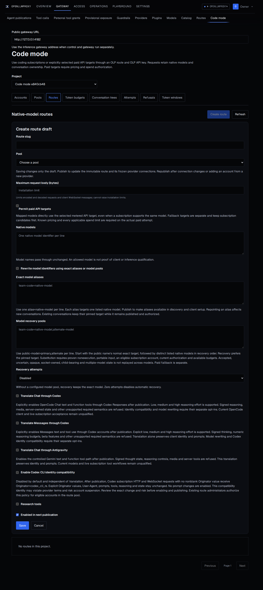
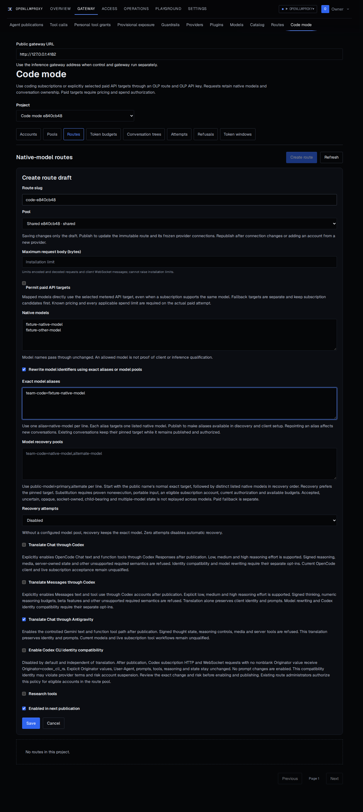
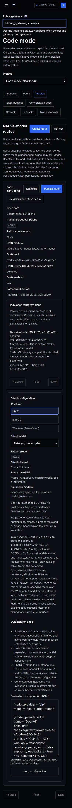
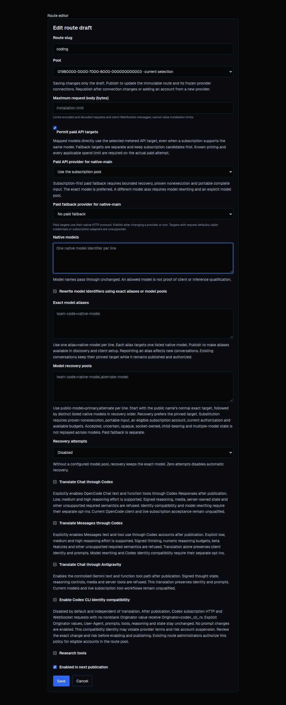
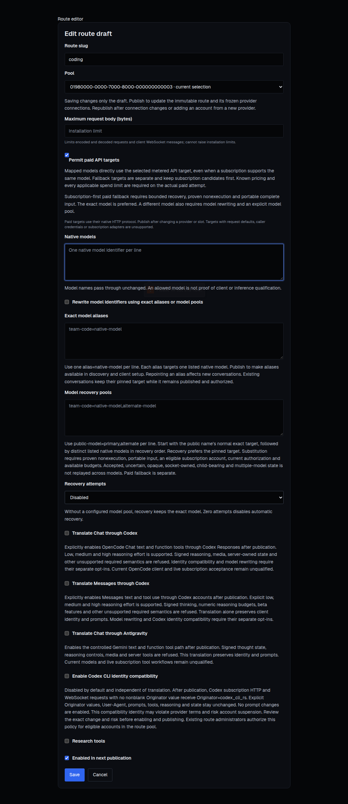

# Code-mode console evidence

These unedited screenshots came from the passing packaged-console journey in [CI run 41033505823](https://github.com/tyk-swe/olp/actions/runs/41033505823), at PR head `609acaee71133feb9a665a548eafd19c9d783652` and checked-out merge `14cf9fca470cc565bcf5bd4576e92e8ef76199f4`. They show before and after configuration in the same build, not a historical bug comparison.

The environment uses fixture subscription metadata and a controlled provider. The captures establish the console workflow and its saved publication assertions, not live subscription qualification. They contain no credentials. The [browser journey](../../../../console/tests/code-mode/management.spec.ts) checks the saved policy, alias, published revision, generated model selection and accessibility before completing.

## Reproduce

1. In the packaged integration browser environment, open `http://127.0.0.1:4182/code-mode` as the fixture owner. Select the prepared `Code mode <suffix>` project with its available subscription account and `Shared <suffix>` pool.
2. Select **Routes**, then **Create route**. The first capture shows the unconfigured form and disabled opt-ins.
3. Fill **Route slug** with `code-<suffix>` and choose the shared pool.
4. Set **Native models** to `fixture-native-model` and `fixture-other-model`, one per line.
5. Enable **Translate Chat through Antigravity** and **Rewrite model identifiers using exact aliases or model pools**. Set **Exact model aliases** to `team-code=fixture-native-model`. The second capture shows these explicit choices before saving.
6. Select **Save**, then **Publish route**, accept the confirmation and open **Revisions and client setup**. Verify revision 1, the alias and the published translation policy.
7. Select `fixture-other-model` as **Client model** and set **Public gateway URL** to `https://gateway.example`. In a 390-pixel viewport, the final capture shows generated setup and its qualification limits.

## Captures

### Before choosing policy

### After choosing policy

### Published client setup on mobile

## Editing paid targets with incomplete model input

The captures below use headful Chromium and the real route editor mounted in a controlled Svelte fixture, with authenticated management state and mocked management reads and writes. They demonstrate editing and validation, without provider or live subscription qualification.

Before the fix, clearing the native model field while paid targets were enabled raised `Enter 1–100 unique native model identifiers, separated by spaces or commas.` during rendering and left the old paid selectors on screen. After the fix, empty input removes those selectors, native form validation prevents saving an empty list, and duplicate input displays the validation message. Restoring `native-main`, choosing its provider and stored credential slot, and saving produced one management write with that exact model and paid target, with no browser exception.

1. Open `http://127.0.0.1:4182/code-mode` in the packaged test environment and edit a route with at least one native model.
2. Enable **Permit paid API targets**, then clear **Native models**. Attempt to save, then enter the same model twice separated by a comma and attempt to save again.
3. Restore one native model, choose its paid provider and credential slot, and select **Save**. The invalid inputs must not save, and the corrected route must save without a browser exception.

| Before the fix, model list cleared | After the fix, model list cleared |
| --- | --- |
|  |  |
