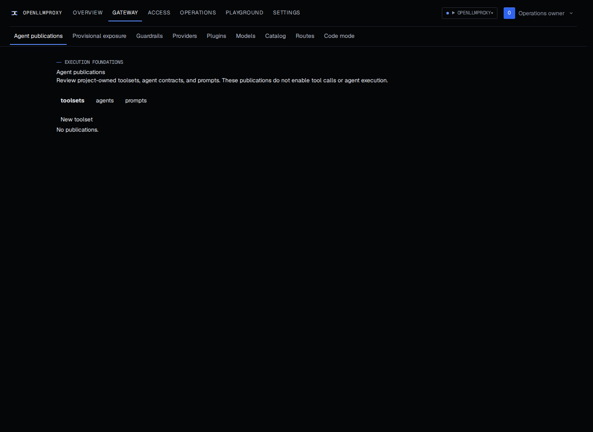
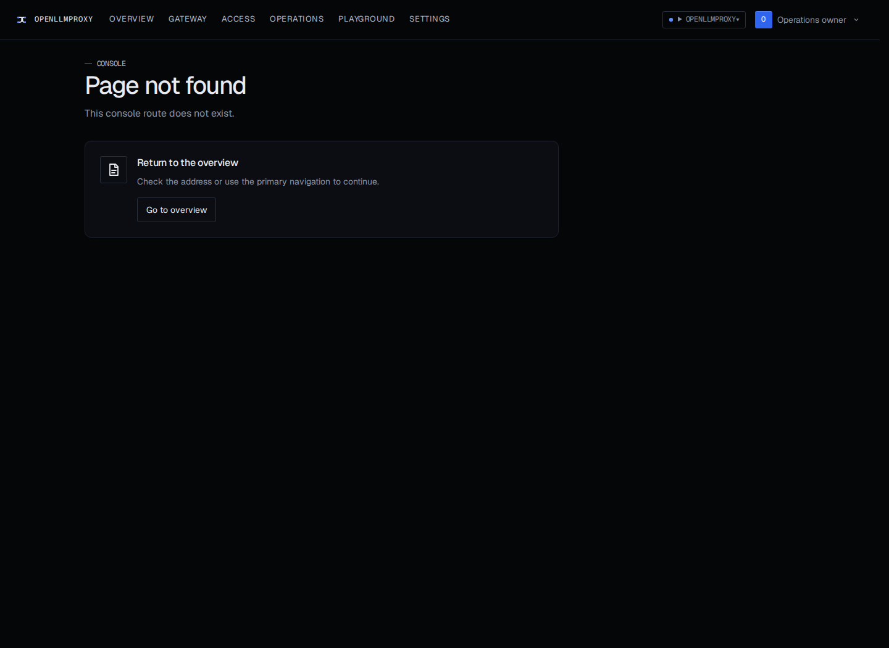
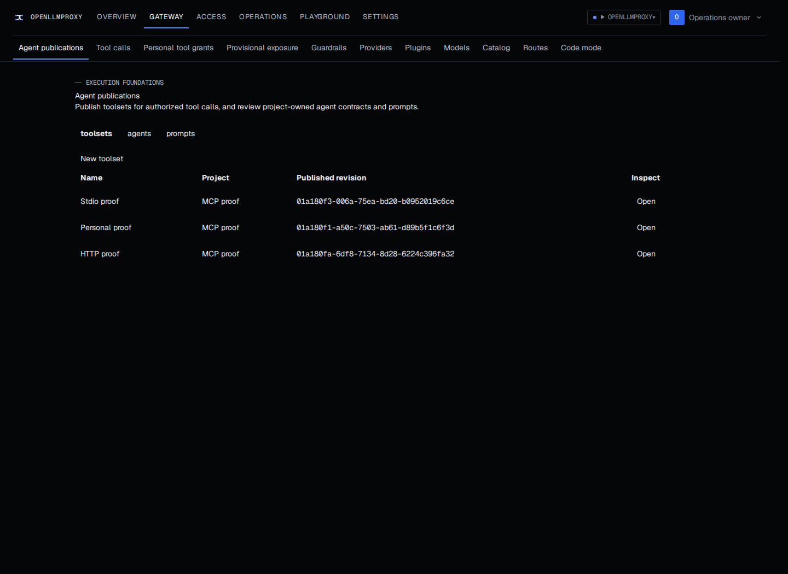
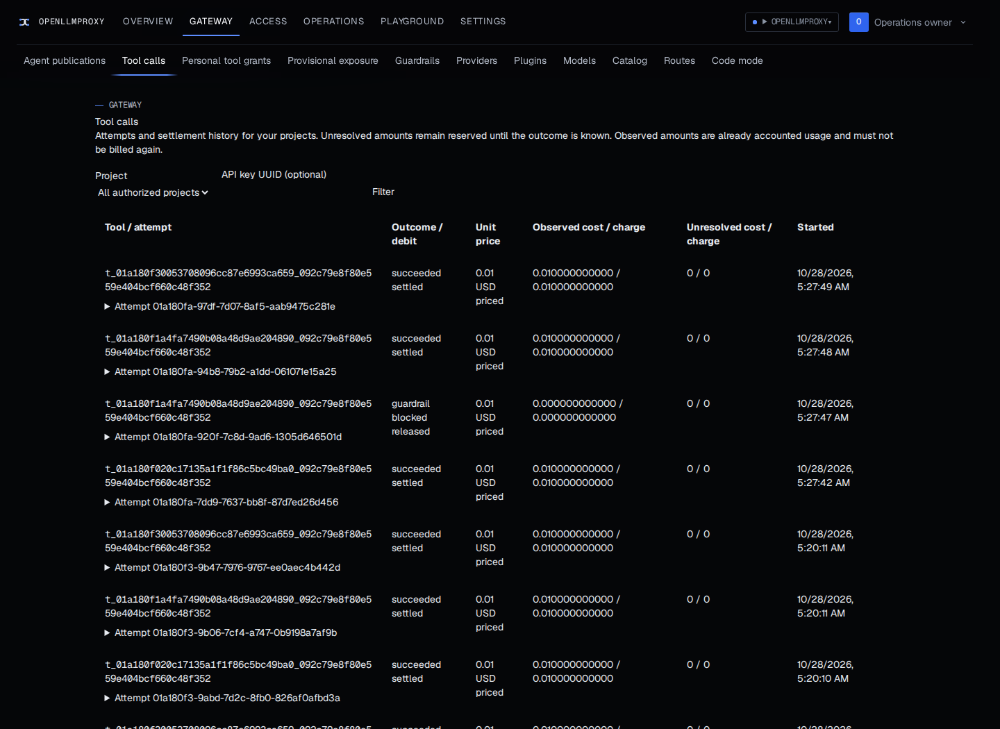
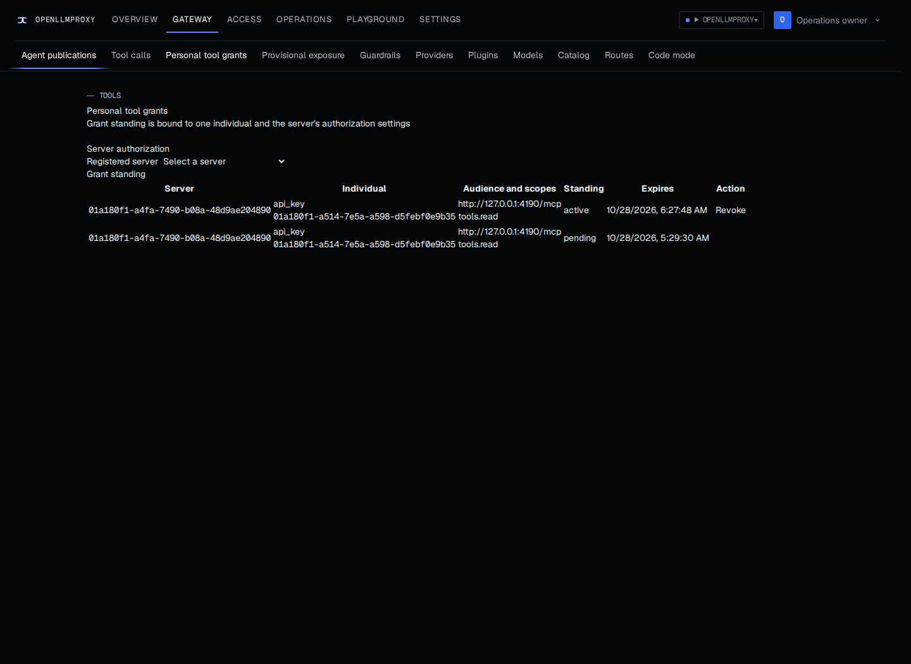
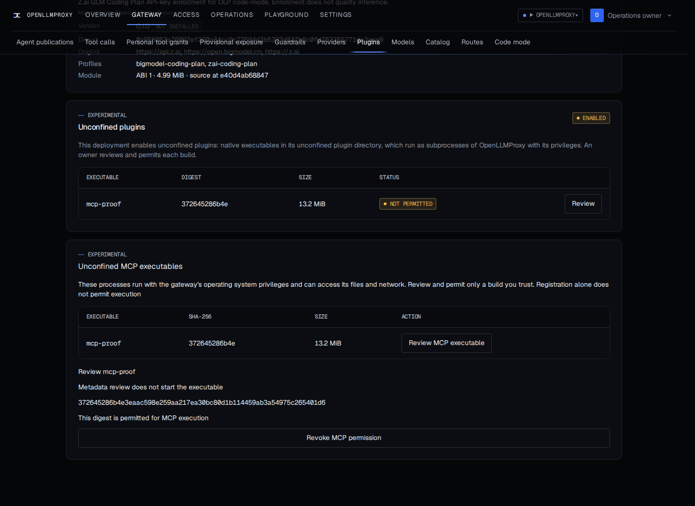

# RM7 consumer MCP proof

These captures use a real Chromium browser, the built gateway, Postgres, Valkey and the [runnable MCP fixture](../../../../tests/fixtures/mcp-proof/README.md). The fixture uses the pinned official MCP SDK and serves HTTP, personal OAuth and stdio. There are no mocked browser responses. All messages, accounts and prices are synthetic.

The baseline is main at `63760828`. The after captures use `94df99ba`, including the final authorization and result-validation fixes. The same evidence database was migrated forward from version 90 through `0103_mcp_entra_obo.sql`. Browser cookies, passwords, API keys and sealed credentials are not included.

The HTTP, enrolled personal and approved stdio calls returned their requested text and structured message. An unenrolled key returned HTTP 403 with `user_grant_required`. Disabling the HTTP server removed its tool from discovery and a new call returned HTTP 404 with `toolset_not_found`. Earlier successful and refused attempts remained visible, with settled and released debit states. The captured responses are in [calls.json](calls.json).

## Reproduce the browser journey

1. Build and start the fixture using its README, then start the gateway with a disposable database and Valkey. Install the same fixture binary as `mcp-proof` in the configured `OLP_UNCONFINED_PLUGIN_DIR` before starting the gateway. In this capture the public gateway URL was `http://localhost:4175` and the HTTP fixture listened on `127.0.0.1:4190`.
2. Sign in as an installation owner. Using the [MCP management API](../../../use/mcp-servers.md), register an enabled HTTP server named `HTTP echo fixture` with the printed MCP URL and a unit price of `0.01`. Publish a toolset named `HTTP proof`, pin its certified `echo` tool, and create a key with `tools` scope and that toolset in `allowed_toolsets`. Submit a call with a fresh call ID and a synthetic `message` argument.
3. Register `Personal OAuth echo fixture` with the same MCP URL and the printed authorization, token and device endpoints. Use client ID `mcp-proof`, the MCP URL as audience and `tools.read` as its scope. Publish `Personal proof` and create its tools key. A call before enrollment must return `user_grant_required`.
4. Open `http://localhost:4175/agents/grants`. Choose the personal server under Registered server, enter the key under API key UUID, and click Start key enrollment. Follow Continue personal enrollment, Claim enrollment, Authorize in browser, Sign in upstream and Complete authorization. The fixture signs in a synthetic user. Confirm active standing, then call the personal tool with its key.
5. Open `http://localhost:4175/plugins`. Under Unconfined MCP executables, click Review MCP executable for `mcp-proof`. Read its digest, acknowledge the unconfined execution notice, click Permit MCP executable, enter Current password and click Confirm. Review does not start the executable.
6. Register `Approved stdio echo fixture` with transport `stdio` and the reviewed executable name and digest. Publish `Stdio proof`, create its tools key and call its pinned `echo` tool. Open `http://localhost:4175/agents` to inspect the three publications.
7. Disable the HTTP server through its update API with the current ETag and required name. Wait until its tool leaves discovery, then issue a new call and confirm refusal. Open `http://localhost:4175/tool-calls` and confirm that earlier attempts and their accounting remain readable. Re-enabling a server that receives a new certified revision requires reviewing and publishing that revision before calling it again.

## Captured request and output

This command was run against the enrolled personal fixture. Set the URL and key for your own disposable installation, and replace the toolset, alias and call ID in [request-personal.json](request-personal.json) when reproducing it.

```sh
curl --silent --show-error --fail-with-body --request POST \
  "$OLP_URL/v1/mcp/tools/call" \
  --header "Authorization: Bearer $OLP_TOOL_KEY" \
  --header 'Content-Type: application/json' \
  --data-binary @request-personal.json
```

The response was HTTP 200. [response-personal.json](response-personal.json) is the captured body, containing the requested message in both text and structured content with `is_error` false.

## Browser captures

Before, publications did not enable execution and the tool-history route was absent.





After, published toolsets have callable tools and history retains accounting after execution is disabled.





Personal grant standing and the explicit native-execution permission remain visible without displaying tokens or private keys.




