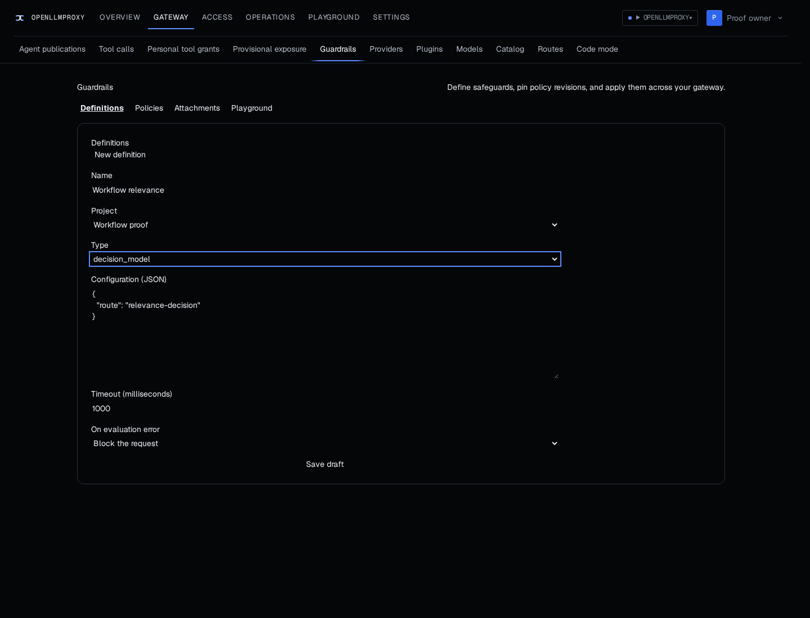
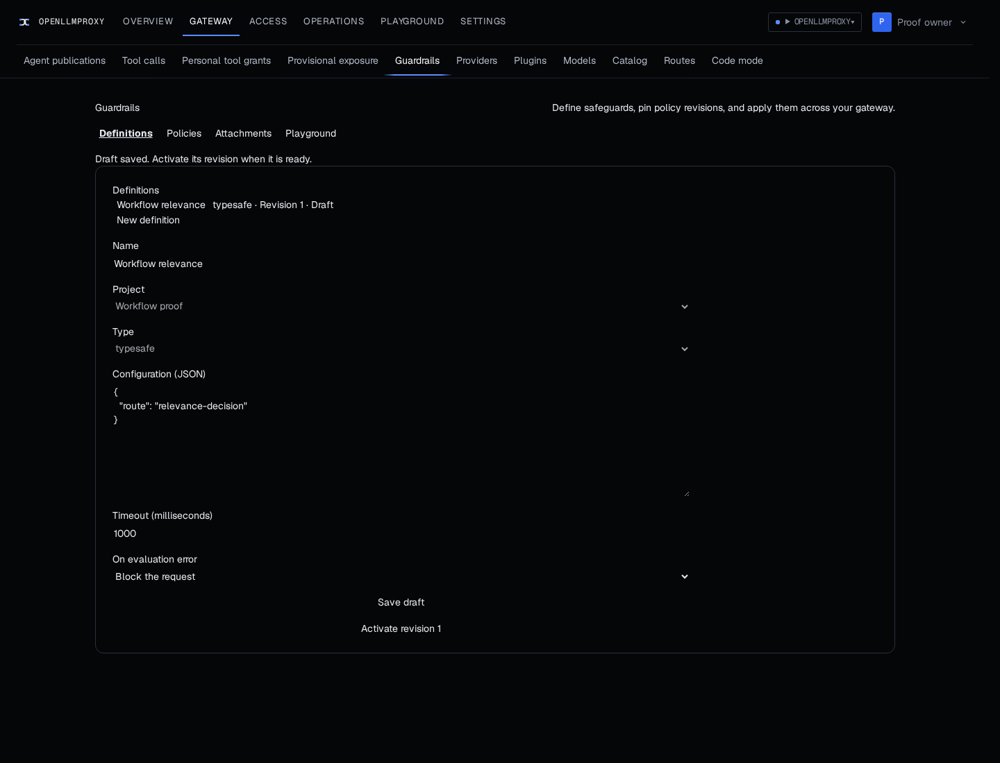

# TypeSafe guardrail proof

These captures use Chromium and the real console and gateway with a disposable PostgreSQL database and an isolated Valkey database. The account and project are synthetic. The baseline uses `a1e0f5c3` and the updated gateway uses `b572f866`. The database was migrated forward between captures. No browser responses were mocked.

The baseline selector has no `typesafe` option. The updated selector offers it and the gateway accepts a draft with the decision route configuration. The draft does not require an external endpoint acknowledgement.

Before

After

1. Start the baseline gateway against an isolated database and open `http://localhost:4195`. Fill Display name, Work email, Password, Confirm password and Setup token. Select Create owner account.
2. Open `http://localhost:4195/access`. Under Projects, enter `Workflow proof` in New project name and select Create project.
3. Open `http://localhost:4195/guardrails` and select Definitions. Enter `Workflow relevance` for Name, select `Workflow proof` for Project and open the Type selector. The baseline has no `typesafe` option. Select `decision_model` and enter `{"route":"relevance-decision"}` in Configuration (JSON) for the [before capture](guardrail-before.png).
4. Stop the baseline gateway, migrate the same isolated database with the updated gateway and start it with the updated console. Sign in and open `http://localhost:4195/guardrails`.
5. Under Definitions, enter `Workflow relevance` for Name, select `Workflow proof` for Project and select `typesafe` for Type. Enter `{"route":"relevance-decision"}` in Configuration (JSON) and select Save draft. The draft appears as TypeSafe revision 1 in the [after capture](guardrail-after.png).
