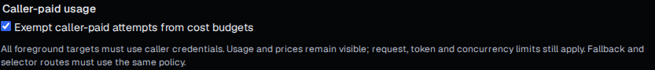

# M1–M4 implementation review

Historical October 2026 implementation record. M1–M4 are implemented; M5/M11
were completed separately. Later whole-source service/browser/release checks are
recorded in [architecture review](../architecture-review.md). Full-rate reference
hardware, paid providers and external IdP/directory results remain separate.

## Scope and evidence

| Requirement | Implementation owners and evidence |
| --- | --- |
| M1 benchmarks/estimation | [Harness](../../tests/bench/README.md), [performance limits](../performance.md), tokenizer oracle fixtures, `internal/gateway/cost_reservation.go` |
| M1 clients/headers | [Exact pins](../clients.md), fixture/SDK/code lanes, response metadata integration tests |
| M2 providers/media/catalog/plugins | Reviewed vendor fixtures, explicit declines, signed catalog/index, startup and tamper tests |
| M3 routing/fleet/supply | Adaptive/runtime tests, `route_resilience_test.go`, fleet/concurrent budget suites |
| M4 end users/budgets | Privacy/HMAC/lookup tests; aggregate/week/timezone/template/temporary-increase regressions |
| M4 access/workload identity | CIDR/group/rotation/reminder tests, issuer/JWKS/mapping/revocation tests |
| M4 enterprise identity | SAML/SCIM/MFA/organization authorization, isolation and browser fixtures |
| M4 caller credentials | Request-local redaction/transport/exemption tests and caller-paid Chromium journey |

Milestone files preserve original scope, numerical criteria and declined
combinations. Operational contracts are consolidated in [access](../access.md),
[routing](../provider-routing.md), [execution](../gateway.md) and
[security](../security.md).

## Cross-cutting review

- Hot paths stay immutable/pinned, with no speculative abstraction or ordinary
  request SQL except retained-resource authority.
- Monetary unknowns refuse; exact decimal/history/calendar semantics do not reset
  on edits. Subscription exemption is distinct from tokens/security.
- Management contract metadata drives auth/generated consumers. Promotion carries
  nonsecret intent; migrations are forward-only.
- Secrets/content stay out of logs/accounting. Named egress/crypto boundaries,
  factor anti-replay, external ownership and current-session fences remain.
- Behavior tests cover cancellation, retries, concurrency, ownership and browser
  controls rather than source-text assertions.

## Validation and remaining evidence

Focused tests at implementation were not a final release campaign. Subsequent
[integrated qualification](../architecture-review.md#recorded-qualification)
covered fixture SDKs/clients, service and browser/recovery paths. That does not
close full-rate S1–S6/LiteLLM/shadow comparisons, live token/provider checks,
external SCIM conformance or production IdPs. “Implemented” never substitutes
for missing acceptance evidence.

