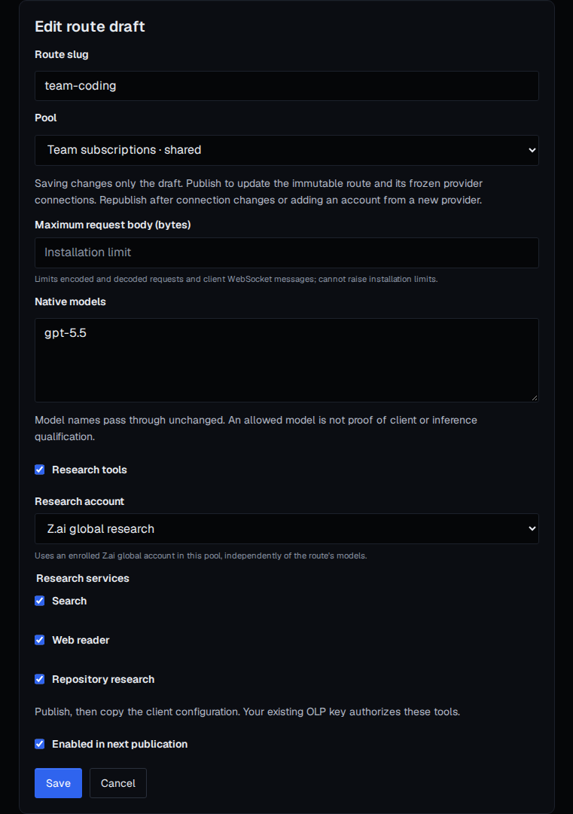

# Code mode

Code mode lets authorized coding clients use enrolled subscription accounts, or
a metered API target that a route explicitly selects, behind OLP access controls.
Each code route has a URL such as `https://olp.example/code/team-coding`.
Requests keep the client's native model name by default, unlike ordinary
inference routes where the published route slug is the model name.

One code route can also mix subscription families. An OpenCode or Claude Code
session might plan with an OpenCode Go model and implement with a GLM Coding Plan
model while each request reaches its own account. See
[Mixing subscriptions](#mixing-subscriptions) for the account and conversation
rules.

Native forwarding is the default because coding clients depend on exact protocol
fields and stream ordering. A published route policy can explicitly enable the
Messages and Chat translations described in this guide. Compatibility behavior
never turns on silently.

Code mode management, its durable ledger and raw transports are implemented. The
official Codex CLI, Claude Code and OpenCode are resolved from npm latest in CI
and qualified against controlled fixtures. Fixture qualification is not a release
claim for a real ChatGPT, OpenCode Go or other coding-plan subscription. Review
the [support matrix and release gates](../develop/qualification.md) before rollout,
and keep the [coding-client baseline and roadmap](../develop/plans/code-mode-parity.md)
separate from the implemented behavior documented here.

## Adapters and clients

Each code account belongs to a subscription family, its **adapter**, which OLP
derives from the plugin profile of the account's provider connection. The
adapter decides which paths the account serves, where upstream they go, how the
upstream credential is placed and which clients OLP generates configuration
for. A route serves the paths of every adapter its published revision froze,
and each request reaches an account whose adapter serves its path. Every other
path refuses before upstream dispatch.

| Adapter | Plugin and profiles | Paths under `/code/{slug}/` | Upstream | Clients (default first) |
| --- | --- | --- | --- | --- |
| Codex | [`codex`](../../plugins/codex/README.md): `codex-subscription` | `responses`, `responses/compact`, WebSocket `responses` | `https://chatgpt.com/backend-api/codex` | Codex CLI |
| Claude subscription, fixture only | [`claude`](../../plugins/claude/README.md), `claude-subscription` | `v1/messages` | `https://api.anthropic.com` | Claude Code, live qualification pending |
| OpenCode Go | [`opencode-go`](../../plugins/opencode-go/README.md): `opencode-go` | `v1/chat/completions`, `v1/messages`, `v1/responses` | `https://opencode.ai/zen/go/v1` | OpenCode, Claude Code |
| GLM Coding Plan | [`zai-coding`](../../plugins/zai-coding/README.md): `zai-coding-plan`, `bigmodel-coding-plan` | `v1/messages`, `v1/chat/completions` | `https://api.z.ai/api/{anthropic,coding/paas/v4}` or the same paths on `https://open.bigmodel.cn/api` | Claude Code, OpenCode |
| MiniMax M Plan | [`minimax-plan`](../../plugins/minimax-plan/README.md): `minimax-plan`, `minimax-plan-cn` | `v1/messages`, `v1/chat/completions` | `https://api.minimax.io/{anthropic,v1}` or the same paths on `https://api.minimax.cn` | Claude Code, OpenCode |
| Kimi Code | [`kimi-code`](../../plugins/kimi-code/README.md): `kimi-code`, `kimi-code-cn` | `v1/messages`, `v1/chat/completions` | `https://api.kimi.ai/coding/v1` or the same paths on `https://api.kimi.com/coding` | Claude Code, OpenCode |
| Qwen Token Plan | [`qwen-token-plan`](../../plugins/qwen-token-plan/README.md): `qwen-token-plan`, `qwen-token-plan-cn` | `v1/messages`, `v1/chat/completions` | `https://token-plan.ap-southeast-1.maas.aliyuncs.com/{apps/anthropic,compatible-mode}/v1` or the same paths on `https://token-plan.cn-beijing.maas.aliyuncs.com` | Claude Code, OpenCode |

The Messages paths speak Anthropic Messages, the chat paths Chat Completions and
the responses paths the Responses API. OpenCode Go serves each model on one
endpoint: most on Chat Completions, MiniMax and Qwen models on Messages and
Grok and GPT models on Responses. OpenCode picks it per model; Claude Code
speaks only Messages, so on OpenCode Go it works only with Messages models.

### Exact model aliases

Enable **Rewrite model identifiers using exact aliases or model pools** in the route editor,
then enter one `alias=native-model` per line in **Exact model aliases**. Each
alias must target one of the route's listed native models. Save and publish to
include the aliases in authenticated model discovery and generated client setup.
An alias uses its target's protocol and client capabilities, even when its name
has no vendor prefix.

The management route write uses `model_rewriting: true` and an `aliases` object,
for example `"aliases": {"team-code": "native-model"}`. This opt-in is independent
of Messages translation and identity compatibility. Native identifiers pass through unchanged unless their public name has an
explicit model pool. Alias requests replace only the protocol's model
identifier, and replies expose the public alias. Prompt content and unrelated
payload fields remain unchanged.

Alias chains, native-name collisions and targets outside the native model list
are rejected. An unavailable target is omitted from discovery and refused for
inference. Without an explicit model pool, an alias always names one exact model and
recovery keeps that exact target.

Repointing an alias and publishing changes the target for new conversations.
Existing conversations retain their durably stored target and account while
that target remains published, eligible and authorized. Removing the old target
or its access refuses the continuation instead of moving it to the new model.
Existing native-model pins are preserved.

### Explicit model recovery pools

Model changes require a published opt-in. In **Model recovery pools**, enter
`public-model=primary,alternate` on each line. The public name can be a native
model or an exact alias. Its first target must match normal exact resolution,
and every target must be distinct and listed under **Native models**. Enable
model rewriting, choose one or two **Recovery attempts**, then save and publish.
Zero attempts disables automatic recovery, including configured model pools.

The management route write carries `model_pools`, for example
`"model_pools": {"team-code": ["native-main", "native-alternate"]}`. Discovery
and client setup expose the ordered targets as policy metadata. Availability
and protocol compatibility are checked again for each selected account.
Configuration and publication do not send inference requests.

Recovery first tries another eligible account for the currently pinned exact
model, then considers the configured targets in order. Substitution requires a
positive nonexecution result and positively portable input. Accepted work,
partial output, uncertain dispatch and opaque input are never replayed. The
existing single-pin root bound still applies. Child-bearing trees, multiple
pins and socket-owned state refuse recovery. Current key and pool authority,
account eligibility, protocol support and applicable budgets are checked before
execution. A missing proven token bound refuses a request with a hard token
budget. An unavailable alternate never bypasses these checks. Paid participation
and paid fallback have separate policies.

The client keeps requesting the same public name. Replies retain that name,
and the recovered exact target and account are stored on the conversation pin.
Later requests retain that target while it remains published, eligible and
authorized. Repointing an alias changes new conversations. Recovery for an
existing pin still tries its stored exact target first, then the currently
published pool order. Removing a pool restores exact recovery for that pin
without moving it back to an earlier target. Attempts record the public
`requested_model` separately from the selected exact `model`. Historical
attempts have an unknown requested model rather than an inferred value.

### Messages through Codex

Enable **Translate Messages through Codex** in the route editor, or set
`messages_to_codex: true` in the management route write, then publish the draft.
The policy is disabled by default and pinned to the published revision. A route
with Codex accounts can then generate Claude Code setup using the same native
model identifiers. Codex remains the default client for those accounts.

The policy translates HTTP `v1/messages` text and tool requests into the Codex
Responses transport. Tool names, call IDs, JSON arguments and text results are
preserved across turns, including fragmented argument streams. Explicit
`output_config.effort` values `low`, `medium` and `high` map to the same
`reasoning.effort` values. `thinking.type: adaptive` is accepted with one of
those explicit effort values. This mapping follows the
[pinned translator](https://github.com/router-for-me/CLIProxyAPI/blob/90c447d3a8727d115aa7552ec93ce023736ed492/internal/translator/codex/claude/codex_claude_request.go#L407-L453)
reviewed on 2026-10-30. Both unary Messages replies and Messages event streams are supported.
System text is preserved in developer input, and the caller's output-token cap
is preserved. Admission, selected-account authorization and usage settlement use
the existing code-mode ledger. Native Messages accounts continue to forward
native payloads unchanged.

The documented Claude `?beta=true` transport flag is accepted and removed before
the Codex request is sent. Signed thinking, opaque reasoning state, numeric
reasoning budgets, error-marked tool results, media, beta headers, unknown query
fields, stop sequences and other unsupported required semantics are refused.
Cancellation and partial upstream failures end the attempt without replay or a
successful Messages terminal event. Missing terminal usage remains unknown in
the ledger. Translation alone does not enable identity compatibility, and prompt
compatibility remains disabled. This translated
path does not establish complete Claude Code qualification. CLI context and beta
requirements and durable opaque state need separate qualification.
Live Codex acceptance, including output-token caps, remains unqualified.

### OpenCode Chat through Codex

Enable **Translate Chat through Codex** in the route editor, or set
`chat_to_codex: true` in the management route write, then publish the draft.
This independent policy is disabled by default and frozen in the published
revision. Generate OpenCode setup through the existing route client-config
endpoint. It declares each offered model explicitly under `olp-codex`, with the
Chat SDK and the route's `/v1` base URL. It does not require those models to be
present in OpenCode's bundled catalog. Exact model names and published aliases
remain the public selection, including planning and small models.

HTTP `v1/chat/completions` text and function tools translate through the Codex
Responses transport. System and developer text, function names, call IDs, JSON
arguments, text results and output-token caps are preserved. Explicit
`reasoning_effort` values `low`, `medium` and `high` map to the same Responses
effort. Unary and SSE replies share the existing Responses codec and native
Codex usage accounting. OpenCode session and parent headers retain code-mode
conversation ownership across tool results, child sessions and cold resumes.
Portable initial requests can use the existing bounded recovery policy after
proven nonexecution. Accepted, partial and ambiguous execution is never replayed.

Signed or opaque reasoning, server-owned continuation state, media, named
messages, unsupported generation controls, beta headers, query parameters and
unknown required fields are refused. Unsupported upstream state fails the
projection while preserving observed usage. Cancellation emits no successful
terminal marker, and missing terminal usage remains unknown. Native Chat,
Messages and Responses forwarding retain their wire behavior. Translation does
not enable the independent Codex identity policy or change prompts. Controlled
codec and SDK fixtures do not establish current OpenCode client acceptance or
live Codex subscription acceptance. Both remain unqualified.

### Codex CLI identity compatibility

This independent route option is disabled by default. Before enabling it, review
its exact behavior and account-suspension risk. For Codex subscription HTTP and
WebSocket requests only, it supplies `Originator: codex_cli_rs` when all supplied
Originator values are absent or blank. It preserves every explicit nonblank
Originator value, User-Agent, other headers and all body content, including
instructions, tools, reasoning and conversation state. It does not add a client
version or platform, change prompts, enable translation or alter required OAuth
authentication signals. Other subscription adapters and paid API targets retain
their native identity behavior.

An existing route administrator can select **Enable Codex CLI identity
compatibility**, save the draft and publish it, or set `codex_cli_identity: true`
through the existing route API and publish. This authorizes the policy for
eligible accounts in the route pool without an additional account-contributor
approval. The editor, API contract and publication confirmation describe the
mutation and warn that using this compatibility identity may violate provider
terms and risk account suspension. Turning the option off also requires
publication. Draft changes leave earlier publications unchanged, and
configuration export and apply preserve draft and published choices separately.

Attempt diagnostics expose `codex_cli_identity_enabled` from the attempt's
frozen route revision. This means the policy was enabled, not that the attempt
used Codex or that a header changed. Diagnostics do not record client identity
header values or prompts. Publication history shows the same frozen policy.

The reviewed behavior is narrower than the pinned compatibility implementation
at [CLIProxyAPI commit 90c447d3](https://github.com/router-for-me/CLIProxyAPI/blob/90c447d3a8727d115aa7552ec93ce023736ed492/internal/runtime/executor/codex_executor_request.go),
which supplies a subscription Originator fallback. The value used here was
reviewed on 2026-10-30 against the official Codex
[default client at commit 5e769a1c](https://github.com/openai/codex/blob/5e769a1cdae3fd93efd5e7b9df71e39efb2223ab/codex-rs/login/src/auth/default_client.rs).
These source references establish the reviewed header policy, not live provider
acceptance. No prompt transformation or live subscription qualification is
claimed.

### Paid API targets

A paid API target is an existing metered provider and credential slot, separate from a coding account or subscription adapter. Enable paid participation in the route editor, select a provider and slot for each native model that should use it, then publish. The management API uses `paid_participation: true` and a `paid_targets` object keyed by exact native model, with `provider_id` and `slot_id` for each entry. The selected provider must be active in the same project and support the native protocol without request defaults, model overrides, caller credentials, plugin adaptation or hosting wrappers.

A mapped model selects its paid target even when a subscription account serves the same model. Subscription failures do not activate paid targets. Aliases resolve an existing conversation pin before provider, credential and pricing selection, provided the selected native model and target remain authorized. Removing access or retiring the binding still refuses continuation. Generic affinity identifiers cannot adopt another conversation through a response reference.

Generated companion models must all use subscription protocols or all use paid API protocols. Setup refuses mixed selections because subscription and paid conversations keep separate ancestry. Paid companions may use different authorized providers and native protocols.

Paid targets currently support native HTTP Responses generation, Messages and Chat Completions. Compaction, prewarming, WebSockets and hosting that requires a different request body are refused before dispatch. Generated coding-client setup requires certified streaming support. A unary-only target remains available through its native HTTP endpoint. Generated Codex setup disables WebSockets for paid models. Discovery marks these models with `paid` and setup returns `paid_models`, without inventing subscription adapters.

Publication freezes the provider revision and slot. Admission checks the current key, project membership, pool assignment, personal ownership, provider, credential, slot restrictions and monetary policy again. Known pricing is required before dispatch. Cost and customer charge can differ through the selected rate card. Key, group, route, project, installation, provider and slot policies retain their applicable rate, token and spend checks. A hard coding-token budget still requires a proven bound, which a native request does not provide merely by specifying an output estimate.

Paid usage records retain the requested and selected model, target ownership, native token counters, cache or media dimensions, pinned price and rate card. Subscription allowance remains separate. Public paid attempts have null subscription `account_id` and `binding_id`, with `paid_binding_id`, `paid_provider_id`, `paid_slot_id` and `paid_monetary_state` identifying their paid lifecycle. The binding filter accepts either ownership type.

#### Paid target runbook

After publishing, check the model catalog and generated client setup before sending a request. A missing target usually means its active revision, credential, slot restrictions or native protocol no longer matches the publication. Republish after an intentional provider or slot change. A pricing refusal requires a current matching price and usable rate card. A spend refusal requires reviewing the applicable cost or charge policy and recorded consumption, rather than changing the request model to bypass the policy.

An interrupted request, missing usage, missing monetary dimension or failed accounting handoff leaves a durable hold for the affected owners after temporary leases expire. Complete measured provider cost can resolve provider and slot exposure while caller cost and charge remain distinct. Known token totals do not make unknown monetary usage free. Review standard usage evidence and accounting-loss records. There is currently no code-specific manual usage-resolution endpoint, so unresolved exposure remains blocked when definitive evidence is unavailable.

HTTP error documents and recognized identity-encoded SSE error events are inspected with the bounded native error scrubber and the credentials actually applied by authentication. Error values are redacted and credential-bearing member names are refused. Successful unary responses and encoded streams retain native delivery without additional error-envelope classification. An oversized or malformed stream frame ends this bounded classification while delivery continues unchanged. Native error observation never persists prompt content or credential material.

### Mixing subscriptions

A pool may hold accounts of several adapters, and a route may list the models
of all of them. Each request reaches an account that lists its model and whose
adapter serves the model on the request's path, with that account's credential,
at that subscription's upstream; a model no adapter serves on the path is
refused with `code_operation_unsupported` before any account is chosen. A
client can use every route model its own protocols reach. With native forwarding,
a model no subscription serves on the client's protocol stays out of that
client's configuration.

| Client | Paths it uses | Models a mixed route can give it |
| --- | --- | --- |
| Claude Code | `v1/messages` | GLM Coding Plan, MiniMax M Plan, Kimi Code and Qwen Token Plan models, and OpenCode Go's Messages models such as MiniMax and Qwen |
| OpenCode | `v1/chat/completions`, `v1/messages`, `v1/responses` | Every coding-plan model, every OpenCode Go model including GPT and Grok, and Codex models with explicit Chat translation |
| Codex CLI | `responses`, `responses/compact` | ChatGPT subscription models only |

To plan with a GPT model and implement with GLM in OpenCode, put an OpenCode Go
account listing `gpt-5.5` and a GLM Coding Plan account listing `glm-5.3` in one
pool, publish a route with both models, and generate the OpenCode configuration
with `model=glm-5.3` and `plan_model=gpt-5.5`. Claude Code can plan the same way
with MiniMax or Qwen using native forwarding. Codex accounts become available
to Claude Code only with explicit Messages translation, and to OpenCode only
with explicit Chat translation.
When several accounts list a model, the conversation's own accounts come first;
see [Conversations and authority](#conversations-and-authority). A conversation
uses one account of each adapter, so the planning and background models must be
ones it reaches with the main model whichever account it pins first: two OpenCode
Go accounts listing different models cannot serve one conversation.

Every request carries the conversation so far, so each subscription a
conversation mixes receives the turns the others produced. No live vendor is
yet qualified to accept another vendor's reasoning and tool calls in that
history; mixed conversations are qualified against scripted vendors only.

## Import Codex credentials once

In the code account editor, select a provider connection using the Codex
subscription profile, paste its `auth.json` into **Codex auth.json**, and choose
**Import Codex credentials**. Save the account to associate the new credential.
This is a one-time migration. OLP stores encrypted credentials and owns refresh
after import. Stop using the original local credentials after a successful import.
OLP does not read, watch or synchronize local files.

The supported JSON document contains a `tokens` object with string fields
`access_token`, `id_token`, `refresh_token` and `account_id`. The token account and
user claims must agree with each other and with `account_id`. Optional top-level
fields are `auth_mode` set to `chatgpt`, `OPENAI_API_KEY` set to `null`, and
`last_refresh` as an RFC3339 timestamp. Other fields, API keys, duplicate JSON
fields and conflicting identities are rejected. Expired local access and identity
tokens are accepted only when refresh verifies the same account and user.

The management API accepts `POST /api/v1/providers/{provider_id}/codex-import`
with the current provider `If-Match` header and a JSON body containing
`credentials`, the document above encoded as a string. Optional `slot_id` selects
an existing credential slot. Otherwise import uses the default slot. OLP verifies
the refresh token through the pinned Codex profile and the provider's approved
network controls before storing it. An occupied slot requires the same verified
principal. The response contains credential metadata and never tokens.

Import preserves account and conversation pins. Replacing an account's credential
requires saving that account with the returned credential identifier. Import and
refresh do not send inference requests or establish subscription eligibility.
This path has controlled-fixture coverage only. Real subscription qualification
remains subject to the release gates linked above.

## Import Claude credentials once

In the code account editor, select a provider connection using the Claude
subscription profile, paste the supported `.credentials.json` document into
**Claude .credentials.json**, and choose **Import Claude credentials**. Save the
account to associate the new credential. OLP encrypts the imported grant and owns
refresh afterward. Stop using the original local credentials after import. This
is a one-time operation. OLP does not read, watch or synchronize local files.

The supported document contains only a `claudeAiOauth` object with opaque string
fields `accessToken` and `refreshToken`, an `expiresAt` Unix timestamp in
milliseconds, and a `scopes` array containing `user:profile` and `user:inference`.
Optional fields are `refreshTokenExpiresAt` and `subscriptionTypeVerifiedAt` as
positive Unix timestamps in milliseconds, `subscriptionType` and `rateLimitTier`
as strings or `null`, `subscriptionTypeSource` set to `sign_in` or `profile`, and
`clientId` matching the supported subscription client's identifier. This format
was checked against the official Claude Code 2.1.314 credential writer. See the
[official authentication documentation](https://code.claude.com/docs/en/authentication)
for local sign-in. API keys, other credential stores, unknown fields, duplicate
JSON fields and unsupported client identifiers are rejected.

The management API accepts `POST /api/v1/providers/{provider_id}/claude-import`
with the current provider `If-Match` header and a JSON body containing
`credentials`, the supported document encoded as a string. Optional `slot_id`
selects an existing credential slot. Otherwise import uses the default slot.
OLP first authenticates the pasted access token against the fixed subscription
profile endpoint. It then refreshes through the pinned Claude plugin and verifies
the same account and organization again, using the provider's approved network
controls. Credentials whose original identity cannot be verified, including
expired or revoked access tokens, require a fresh local sign-in before import.
OLP does not infer identity from opaque token contents or local metadata.

An occupied slot requires the same verified principal. Account or organization
changes are rejected without modifying the existing account or its conversation
pins. The response contains credential metadata and never tokens. Same-identity
replacement preserves pins after the account is saved with the returned
credential identifier. Import and refresh do not send inference requests or
establish subscription eligibility. This path has controlled-fixture coverage
only. Real subscription qualification remains subject to the release gates
linked above.

## Research tools

Research tools use a pool account independently of the coding model. A route
serving only GPT can use a Z.ai global GLM Coding Plan account to search
documentation, read a webpage and inspect a public repository. GLM does not need
to appear in the route's model list.

In the existing route editor, enable **Research tools**, select an eligible
Z.ai global account from the route's pool, and choose **Search**, **Web reader**
and/or **Repository research**. The sole qualifying account is preselected.
Inference health cooldowns and exhausted coding allowances do not remove an
otherwise enrolled research account; management reports `research_eligible`
separately from inference `eligible`.
Save and publish, then open **Client configuration**. Existing keys with the
`inference` scope, route access and pool membership can use the enabled services;
no model selection, conversation binding or separate MCP registration is needed.



The management route write accepts an optional binding:

```json
{
  "tools": {
    "account_id": "11111111-1111-4111-8111-111111111111",
    "services": ["search", "reader", "zread"]
  }
}
```

Omitting `tools` or setting it to `null` disables research in the next
publication. Draft changes take effect only after publication. Account and
service selections are frozen with the route revision, alongside its provider
connections. The account must remain enabled, enrolled in the same project and
assigned to that pool. Only `zai-coding-plan`, the global profile, qualifies.

| Service | Route endpoint | Upstream service | Exposed tools |
| --- | --- | --- | --- |
| Search | `/code/{slug}/mcp/search` | `web_search_prime` | `webSearchPrime` |
| Web reader | `/code/{slug}/mcp/reader` | `web_reader` | `webReader` |
| Repository research | `/code/{slug}/mcp/zread` | `zread` | `search_doc`, `get_repo_structure`, `read_file` |

Upstream endpoints are fixed at
`https://api.z.ai/api/mcp/{upstream_service}/mcp` and use the account's enrolled
grant through the published connection's egress, proxy and TLS controls.
Vision, client roots, sampling and local-file forwarding are outside this
surface. The management MCP endpoint and project-owned MCP registrations are
separate features.

### Client setup

Set `OLP_API_KEY` in the client environment. Merge generated entries into
existing files, preserving other MCP servers, tools and settings. Server names
include the route slug and service. Users choose which tools to invoke in their
client; generation does not disable built-in tools.

- **Codex:** the generated TOML includes `[mcp_servers."olp_<slug>_<service>"]`
  tables with a route endpoint and `bearer_token_env_var = "OLP_API_KEY"`.
- **OpenCode:** generated `opencode.json` includes remote `mcp` entries with
  `oauth: false` and `Authorization: "Bearer {env:OLP_API_KEY}"`.
- **Claude Code:** source the generated shell setup as before and merge the
  companion `.mcp.json` into the project. Its HTTP entries use
  `Authorization: "Bearer ${OLP_API_KEY}"`. The management response returns this
  companion in optional `additional_files`; the console displays and copies
  every required file. Approve project MCP servers through Claude's normal flow.

These formats follow the official [Codex MCP configuration](https://developers.openai.com/codex/mcp),
[OpenCode remote MCP configuration](https://opencode.ai/docs/mcp-servers/), and
[Claude Code environment expansion](https://code.claude.com/docs/en/mcp#environment-variable-expansion-in-mcpjson).
Vendor credentials stay on the gateway.

### Authorization and transport

Every POST, GET stream and DELETE checks the live key, end-user policies, route
publication, pool membership, account and grant. OLP translates upstream session
IDs to opaque IDs bound to the key, route revision, service, account, credential and grant
generation. Stateless upstreams also receive an OLP session fence, without
forwarding an invented session ID to the vendor. Initialize first and send the
returned OLP session ID on subsequent requests. Republishing or rotating
credentials requires initialization again; another key cannot reuse a session.
Rotation reclaims obsolete sessions across all research services for the route.
State is shared across gateway replicas,
expires after one idle hour or 24 hours total, and is limited to 32 sessions per
key and 10,000 per installation. Session creation reclaims expired metadata.
SSE resume IDs are authenticated to the OLP session and credential, so an event
ID from another key or session cannot resume a stream, including on stateless
upstreams. OLP translates valid resume IDs back to native upstream IDs.
Session state is tentative until a valid initialization result for the request
reaches the client. Failed, malformed or interrupted handshakes release their
session slots, including JSON delivery failures and client cancellation. A delayed handshake cannot retire sessions from a newer
publication or credential generation. SSE response headers are flushed
immediately, including for idle streams that initially contain only heartbeat
comments. Upstream heartbeat comments also reach the client while waiting for
data; write deadlines apply while sending data, without shortening idle
HTTP/2 streams.

The proxy answers upstream [MCP pings](https://modelcontextprotocol.io/specification/2025-11-25/basic/utilities/ping)
locally after rechecking live authorization and the session's credential
generation, including end-user blocks added while the stream is open. Ping
replies use the stream's existing admission, with at most 32 replies per stream
and five seconds per reply. Other server callbacks remain
disabled.

The proxy supports [MCP Streamable HTTP](https://modelcontextprotocol.io/specification/2025-11-25/basic/transports):
initialization, paginated discovery, calls, notifications, cancellation, JSON,
SSE event IDs and session termination. Discovery exposes only the listed tools;
native schemas, structured results, source references and tool errors pass
through. Each request is bounded to two minutes, 1 MiB of input, 8 MiB of
upstream output and 1 MiB per SSE event; installation and route body limits can
lower the input limit. Key and connection request/concurrency limits also apply.
GET notification streams use separate concurrency counters per service at the
key, group, route, end-user and provider boundaries. They do not occupy tool-call
slots, and request-rate counters remain shared with other research requests.
Session-scoped lifecycle and progress notifications retain request-rate limits
without needing another work slot. This lets initialized notifications complete
an open SSE handshake and cancellation stop an active tool call.
Research has no inference token usage, token-rate reservation or hard token
reservation.

Published research uses the route's frozen provider connection. Staging a new
provider draft does not change dispatch until the route is published again.

Dispatched calls are never replayed or moved to another account. Service errors
and tool allowance errors do not change inference account health or affect other
services. Arguments, results and credentials are never written to diagnostic
ledgers; retained session rows contain only transport and authorization metadata.
Controlled fixtures qualify this boundary; live subscription and real-client
research qualification remain release gates.

## Operator workflow

Code accounts, pools, routes and budgets belong to projects. A management session
or management token needs the existing configure authority and project-manager
or global authority to change them. Read access is project-scoped. Session
mutations require CSRF protection; use `Idempotency-Key` on creation, publication
and retirement, and `If-Match` on updates and publication.

1. Enroll the account through the provider's supported authorization flow. OLP
   stores encrypted grant material under a credential version and its observed
   principal. A generic OAuth plugin demonstration does not establish supported
   Codex account authorization. Do not paste an access token into a developer's
   CLI or mark a fixture account as production-qualified.
   - Codex enrolls through the official device sign-in.
   - Claude uses headless browser sign-in. Open the authorization URL, sign in
     upstream, and paste its returned `code#state` or full HTTPS callback into
     OLP. The profile endpoint verifies account and organization identity on
     enrollment and every refresh. Health stays unknown. Native forwarding and
     tool exchanges have controlled fixtures, while live subscription inference
     remains unqualified. See the [plugin guide](../../plugins/claude/README.md).
   - OpenCode Go and the coding plans enroll a pasted API key: the operator opens
     the vendor's key page, creates a key and pastes it into a masked field. OLP
     makes no upstream call; it stores the key encrypted and takes a SHA-256
     fingerprint of it, scoped to the profile, as the principal. The key never
     expires or refreshes. A different key is a different principal, so rotating
     a key means a new code account; conversations pinned to the old account
     must start again. Revoke the old credential version, because nothing
     retires it automatically.
2. Create a code account with `project_id`, `provider_id`, `credential_id`,
   `name`, `enabled` and an explicit `models` array. Account identity survives
   credential rotation only when both provider and principal remain the same.
3. Create a pool and assign accounts and API keys explicitly; accounts of
   several adapters may share one. A `shared` pool has no owner. A `personal`
   pool names `owner_user_id` and accepts only keys
   issued by that owner. Being a project member does not itself grant pool use.
   In the console pool editor, set each selected account's weight, or send
   `account_weights` keyed by account ID in the pool API. Weights are integers
   from 1 to 2147483647, and omitted accounts default to weight 1. Larger weights
   give eligible accounts a larger share of new conversations. Accounts must
   still support the exact model, protocol and transport and be available.
   Weight changes affect new account selections. Existing bindings and model
   pins keep their accounts across resumes, reconnects and child conversations.
4. Create a route with a stable `slug`, `pool_id`, `models` and `enabled`, then
   publish it; each model needs an enrolled pool account that lists it. The
   published revision freezes connection configuration. Adding
   an account backed by a previously absent provider requires republishing the
   route before that connection can serve it.
5. Give the developer an OLP inference key and the supported route configuration.
   Keep grant access/refresh tokens and account authorization in OLP. The generated
   configuration surface states the latest client channel, model list and gaps; CI evidence records exact versions.
   In the console's Code mode page, set the public gateway URL before copying it.
6. Inspect account eligibility, bindings, attempts, refusals and token windows.
   Retire a binding to stop its entire tree. A retired or unavailable conversation
   fails; the caller must explicitly start a new conversation to choose again.

All lifecycle actions must avoid synthetic inference, including enrollment,
account activation, refresh, publication, health checks and background maintenance.
Initial `health: unknown` and a current grant do not imply successful inference
qualification. Ordinary provider probe/certification workflows are not code-mode
activation checks.

### Management surface

| Operation | Endpoint |
| --- | --- |
| List/create accounts, pools, routes, budgets | `GET`/`POST /api/v1/code/{accounts,pools,routes,budgets}` |
| Update one resource | `PUT /api/v1/code/{collection}/{id}` |
| Publish an immutable route revision | `POST /api/v1/code/routes/{id}/publish` |
| Inspect route history | `GET /api/v1/code/routes/{id}/revisions` |
| Generate client configuration | `GET /api/v1/code/routes/{id}/client-config?gateway_url=...&client=...&model=...&plan_model=...&small_model=...` |
| Inspect metadata | `GET /api/v1/code/{bindings,attempts,refusals,token-windows}` |
| Retire the root of a conversation tree | `POST /api/v1/code/bindings/{id}/retire` |

Lists support `project_id`, `cursor` and `limit`; diagnostics additionally support
the applicable `route_id`, `api_key_id`, `account_id` and `binding_id` filters.
A binding matches `account_id` through its first account or any of its tree's pins.
Use collection results' ETags when updating resources. The API and console must
ship together; a backend-only deployment does not meet the complete product contract.

## Client configuration

Client configuration reads the published revision and the accounts of its pool.
`supported_clients` lists the clients the route's subscriptions support, in the
order of the route's models, and `client` defaults to the first. `native_models`
are the route models the client can reach, those listed by an account whose
adapter supports it, and `model` defaults to the first; `adapters` names the
subscriptions they come from. `plan_model`, for planning, and `small_model`, for
background requests, default to `model`; Codex takes neither. A client no
subscription supports, or a model the client cannot reach, is a 422. No
configuration ever contains an OLP key: each reads it from `OLP_API_KEY`.

Choose Linux, macOS or Windows in the console before copying the setup. API
callers pass `platform=linux`, `platform=macos` or `platform=windows` to
`GET /api/v1/code/routes/{id}/client-config`. An omitted platform defaults to
Linux for existing callers. The response includes `platform`, `instructions`
and the destination in `file`. Linux and macOS use a POSIX shell. Windows uses
PowerShell, including `$env:OLP_API_KEY`. Choose Linux when running inside WSL.

Treat the generated configuration as a fragment. For Codex, update the root
`model` and `model_provider` settings and replace only `model_providers.olp` in
the user configuration. The path is `$CODEX_HOME/config.toml`, defaulting to
`$HOME/.codex/config.toml`. In PowerShell, these paths are
`$env:CODEX_HOME\config.toml` and `$HOME\.codex\config.toml`. Do not put the
provider in a project-local `.codex/config.toml`, where Codex ignores provider
and authentication settings. Merge MCP tables by name without duplicating TOML
keys or tables, preserving unrelated settings and servers.

For OpenCode, merge the generated fields into the project's `opencode.json`,
or its existing `opencode.jsonc`. Update the selected models and provider list,
including `agent.plan.model` when planning uses the main model again. Preserve
other plan-agent settings while merging provider, agent and MCP entries by name,
and retain other tools and settings. Keep environment references intact. For Claude Code, save the shell
setup as `olp-claude.sh` on Linux or macOS, or `olp-claude.ps1` on Windows.
Source it with `. ./olp-claude.sh` or `. .\olp-claude.ps1`, then launch `claude`
in the same shell. The setup changes the process environment without writing
`settings.json`. Merge companion MCP entries into the project `.mcp.json` and
approve the project servers in Claude Code.

These paths and merge rules follow the official
[Codex configuration reference](https://developers.openai.com/codex/config-reference/),
[Claude Code settings](https://code.claude.com/docs/en/settings),
[Claude Code environment variables](https://code.claude.com/docs/en/env-vars) and
[OpenCode configuration](https://opencode.ai/docs/config/) documentation, checked
on 2026-10-30. The generated platform setup has renderer tests and a Linux
shell evaluation check. This does not establish native client startup on
Windows or macOS, or live subscription qualification on any platform.

### Codex

The controlled suite resolves the unmodified official Codex CLI from npm **latest** on each run. This
example demonstrates its tested provider configuration, not a real-account
qualification or a substitute for OLP's generated configuration:

```toml
model = "gpt-5.4"
model_provider = "olp"

[model_providers.olp]
name = "OpenAI"
base_url = "https://olp.example/code/team-coding"
env_key = "OLP_API_KEY"
wire_api = "responses"
requires_openai_auth = false
supports_websockets = true
http_headers = { "X-OLP-Code-Model" = "gpt-5.4" }
```

Supply only the OLP key as `OLP_API_KEY`. No workstation ChatGPT login is used in
the controlled tests. `gpt-5.4` is a native model identifier, not the route slug
and not proof that a particular account is entitled to it. Select only a model
allowed by the published route and enrolled account.

The generated configuration retains Codex's default request and stream retries.
Controlled tests cover interrupted-stream retries, WebSocket reconnect and HTTP
fallback. OLP forwards each inference once by default. An explicitly published
[initial recovery policy](#portable-conversation-recovery) can permit bounded
additional attempts after proven nonexecution and portable initial state. Every
client retry gets fresh admission on its durable conversation account. A 503 can
quarantine that account, and subsequent retries fail without dispatch until its
cooldown expires.

`X-OLP-Code-Model` is an OLP-only selection hint for the initial WebSocket
handshake, before the native body arrives. It is removed upstream. It cannot
change an existing account pin or bypass the model check on each generation.
Generate configuration again with `model=<chosen-native-model>` when changing
models. The controlled suite checks that `-m` changes the body but **does not update** this static
header; an override alone can pin an incompatible account. Arbitrary `-m`
overrides are not qualified for disjoint-model pools.

### Claude Code

The controlled suite resolves Claude Code from npm **latest** on each run. OLP
generates a POSIX shell file for Linux and macOS, or a PowerShell file for
Windows, to source before starting `claude`. The POSIX setup includes:

```sh
unset ANTHROPIC_API_KEY ANTHROPIC_SMALL_FAST_MODEL CLAUDE_CODE_USE_BEDROCK CLAUDE_CODE_USE_VERTEX CLAUDE_CODE_USE_FOUNDRY
export ANTHROPIC_BASE_URL='https://olp.example/code/team-glm'
export ANTHROPIC_AUTH_TOKEN="${OLP_API_KEY:?Set OLP_API_KEY to your OLP inference key}"
export ANTHROPIC_MODEL='glm-5.3'
export ANTHROPIC_DEFAULT_OPUS_MODEL='glm-5.3'
export ANTHROPIC_DEFAULT_SONNET_MODEL='glm-5.3'
export ANTHROPIC_DEFAULT_HAIKU_MODEL='glm-5.3-flash'
export CLAUDE_CODE_SUBAGENT_MODEL='glm-5.3'
export CLAUDE_CODE_DISABLE_NONESSENTIAL_TRAFFIC=1
```

With a `plan_model` other than `model`, the file sets `ANTHROPIC_MODEL` to
`opusplan` and `ANTHROPIC_DEFAULT_OPUS_MODEL` to the planning model. Claude Code
then plans on the planning model in plan mode and uses
`ANTHROPIC_DEFAULT_SONNET_MODEL`, the native model, for everything else.

Every model variable names a native model the route admits, so background,
subagent and classifier requests stay on the route; Claude Code otherwise
sends Anthropic model names the route refuses. `ANTHROPIC_AUTH_TOKEN` sends the
OLP key as a bearer token, and the file unsets a workstation `ANTHROPIC_API_KEY`. The
non-secret variables may instead go in the `env` block of
`.claude/settings.json`; keep the key in the environment. Z.ai's guide suggests
`API_TIMEOUT_MS` and `CLAUDE_CODE_AUTO_COMPACT_WINDOW`; a generation through OLP
is limited to ten minutes whatever the client timeout, and OLP does not know a
model's context window, so set the latter yourself if you need it.

Claude Code's `HEAD /api/hello` connectivity probe and `count_tokens` are not
served; it falls back to local estimates. Vendor-native server tools and
claude.ai login features are outside code mode. Optional
[research tools](#research-tools) are exposed through the companion MCP setup.

### OpenCode

The controlled suite resolves OpenCode from npm **latest** on each run. OLP generates an `opencode.json`
that overrides the base URL of OpenCode's own provider for each subscription:
`opencode-go`, `zai-coding-plan` for either GLM profile, `minimax-coding-plan` for
either MiniMax profile, `kimi-code-plan-global` for either Kimi profile or
`alibaba-token-plan` for either Qwen profile. Each model is listed
under the provider of the subscription that serves it, and every provider points
at the route. The provider picks the endpoint OpenCode sends a model on, so for
a model both subscriptions offer OLP picks the providers with which one
conversation reaches the main, planning and background models together. With a `plan_model` other than `model`, OpenCode's plan agent uses
the planning model and its build agent `model`. For a route mixing both plans:

```json
{
  "$schema": "https://opencode.ai/config.json",
  "model": "zai-coding-plan/glm-5.3",
  "small_model": "zai-coding-plan/glm-5.3",
  "agent": { "plan": { "model": "opencode-go/gpt-5.5" } },
  "enabled_providers": ["opencode-go", "zai-coding-plan"],
  "provider": {
    "opencode-go": {
      "options": { "baseURL": "https://olp.example/code/team-mix/v1", "apiKey": "{env:OLP_API_KEY}" },
      "whitelist": ["gpt-5.5"]
    },
    "zai-coding-plan": {
      "options": { "baseURL": "https://olp.example/code/team-mix/v1", "apiKey": "{env:OLP_API_KEY}" },
      "whitelist": ["glm-5.3"]
    }
  }
}
```

Generated OpenCode settings define each reachable model and its native SDK,
including models absent from the client's bundled catalogue.
`enabled_providers` stops OpenCode loading other providers; `small_model` keeps
title generation on the route. Never run `opencode auth login` for the plan on a
developer machine. OpenCode asks the npm registry for its own dependencies at
startup; that is not model traffic.

`GET /code/{slug}/models` and `GET /code/{slug}/v1/models` return the published
models currently served by eligible pool accounts, their native protocol paths
and transports, and supported clients. Authenticate with the same OLP inference
key used for requests. Key revocation, pool membership, account availability,
and credential eligibility apply to every discovery request. Generated setup
uses the same catalog and returns it in `models`; discovery does not contact
upstream services or report account identities. The catalog is a current view,
not a guarantee that a later request will succeed.

## Conversations and authority

### Generic protocol access

An authorized client can send complete native Responses, Messages or Chat
Completions requests to the paths its published route serves. An OLP key with
the `inference` scope, route permission and pool membership is sufficient.
Private coding-client identity headers are optional. For example, set
`OLP_API_KEY` to your project key and `OLP_NATIVE_MODEL` to a model the route
allows, then send a complete Responses request to a Codex-backed route.

```sh
curl --fail-with-body https://olp.example/code/team-coding/responses \
  -H "Authorization: Bearer ${OLP_API_KEY}" \
  -H 'Content-Type: application/json' \
  --data "{\"model\":\"${OLP_NATIVE_MODEL}\",\"input\":\"Explain what this function does\",\"store\":false}"
```

Use `/v1/responses`, `/v1/messages` or `/v1/chat/completions` with the matching
native body for other adapters. Native forwarding, model names and explicit
translation or model-alias policies apply as usual. OLP preserves native bytes
and unknown extensions and supplies the selected account's credential. It adds
a Codex identity fallback only when the separate policy is enabled and published.
Provider access rules still apply, and accepting a generic request locally does not establish live provider
qualification.

Without affinity, each HTTP request starts an independent conversation. Send
the complete text and function-tool history needed for that request. To keep
the same account binding across requests, add `X-OLP-Code-Affinity` with a stable
identifier of at most 256 bytes. The header must contain one nonempty value
without surrounding whitespace. OLP consumes it locally and scopes the binding
by route and API key, so equal values from different keys or projects do not
share a conversation. The value selects no recognized client's parent or child.
Generic WebSocket Responses require this header on the handshake.

With explicit affinity, `previous_response_id` may continue a response OLP
observed for that key and conversation, subject to its producing account and
model ownership. Unknown, ambiguous or differently owned references refuse.
An affinity cannot adopt another affinity's conversation or a recognized
client's tree through a response reference. Without affinity, response
references refuse. Generic requests also refuse opaque or signed thinking
history, turn state, compaction, stored prompts, stored item/file references,
server tools and other unsupported stateful content. Complete
function-call arguments and tool results remain native input, including fields
that happen to have names such as `signature`. OLP never converts opaque state
into a stateless prompt. Every admitted generation uses the same live access,
limits and accounting checks described below.

### Recognized client lineage

Recognized clients name their conversations in headers OLP reads and forwards unchanged.

| Client | Conversation | Child conversation |
| --- | --- | --- |
| Codex | `thread-id` or `session-id` | `x-codex-parent-thread-id` with `x-openai-subagent` |
| Claude Code | `x-claude-code-session-id` | `x-claude-code-agent-id`, beneath `x-claude-code-parent-agent-id` or the session |
| OpenCode | `x-opencode-session-id` | beneath `x-opencode-parent-session-id` |

A Claude Code agent is scoped by its session, as `session/agent`, because
teammate agents reuse name-based identifiers. Identifier bytes outside letters,
digits, `.` and `-` are encoded as `:xx`, so OpenCode's `ses_…` appears as
`ses:5f…`. Mixing recognized client families or combining their identities with
`X-OLP-Code-Affinity` refuses. The Codex paths accept Codex identities, and the
`v1/` paths accept Claude Code or OpenCode identities. Recognized identities
keep their existing conversation and parent lineage.

The first admitted top-level conversation selects one eligible pool account and
atomically persists its binding. The first admission of each model in the
conversation tree pins one account to that model. A tree uses at most one
account of each subscription family, so a new model takes the tree's first
account, or else another account the tree already uses, when it lists the model
and serves the request's path; otherwise it takes the first available eligible
account of a family the tree does not use yet. Another account of a family the
tree already uses never joins it, which keeps a vendor's conversation state on
one account. When a republish puts two of a tree's accounts in one family, the
account the tree used first keeps serving and the other refuses its pinned
models. Each pin records its account's family, so a family stays the tree's
after a republish drops that account. Concurrent first turns on different
replicas must resolve to the same binding and pins. Resumes, reconnects, children, compaction and client
retries keep each model's pinned account. A child with an unresolved parent is
refused instead of receiving a new account. Bindings list their tree's pins.

Translated Messages requests use the same durable bindings and pins. Reusing a
session and agent identifier after a gateway restart resumes that agent's
account ownership. Send the complete portable text and tool history, or an
explicit text summary after client compaction. OLP stores identity and account
metadata rather than prompts or history. Signed thinking, redacted reasoning
and opaque compaction blocks that cannot be represented refuse with
`code_translation_unsupported_semantics` before dispatch. Use a native Messages
account when those blocks are required.

A `previous_response_id` belongs to the account that produced it, scoped to the
route and API key. It cannot continue on another account in the same conversation
tree. A conflicting owner returns `code_response_account_conflict`. Unknown or
ambiguous ownership returns `code_parent_unresolved`. Legacy references remain
usable when the tree's dispatched attempts prove a single producing account.
Otherwise, start a new conversation with full context and no response reference.

Fresh `codex exec review` is a child-first workflow. With the generated
WebSocket-enabled configuration, controlled tests observe a root handshake
establishing its pin before the review child, without parent inference. This
also works when the upstream rejects WebSockets with 426 and Codex falls back
to HTTP after OLP has established the root. Disabling WebSockets from the outset
leaves the parent unresolved and correctly returns `code_parent_unresolved`.
The official app-server can also review a thread after a real user task on that
thread, over either transport. Do not send a dummy inference merely to acquire
a parent pin. Parent establishment must reach OLP; an external proxy that blocks
the root handshake before OLP is not qualified by the fallback test.

Every generation rechecks key/project/route/pool permission, account eligibility,
grant state and limits. A WebSocket upgrade is not lasting authorization to
generate. Revocation, retirement, an unavailable account, exhausted allowance or
an unsupported model never triggers silent account switching; a cooling
account the tree would take for a new model refuses that model too. A credential
refresh may change authentication for the same principal; it must not change
the principal stored in the binding.

## Limits and accounting

Request rate, token rate and concurrency reuse shared admission. Those estimates
do not establish hard token bounds. Subscription traffic excludes ordinary
monetary spending limits; dollar estimates are informational.

Hard token budgets are optional. An enabled matching budget requires an
adapter-proven conservative bound before dispatch. Project-wide, route-scoped and
key-scoped budgets overlap; all applicable UTC daily/monthly windows reserve
atomically. An operation without a trustworthy bound returns
`code_token_bound_unavailable` only when a matching hard budget is enabled.
Disabling a budget does not erase previous consumption or uncertainty.

The current qualification has **no proven native Codex generation bound**.
`max_output_tokens`, model context metadata, prompt estimates, a test constant or
an operator-entered number cannot be treated as proof. Positive hard-budget
support remains a release gate rather than an always-reject implementation claim.

After dispatch, final provider usage settles reservations exactly once. Cached
input and reasoning output are subsets of input/output totals. Anthropic
Messages input includes cache reads and writes, and its cached input is the
cache reads. Chat Completions reports usage only in a final chunk when the
client asks for it with `stream_options.include_usage`, as OpenCode does; a
stream without it leaves its consumption uncertain. A disconnect,
cancellation or missing final usage leaves durable uncertainty and does not
release a reservation as unused. A bound overrun is a `bound_violation` and must
block subsequent budgeted admission. Historical unknown usage prevents falsely
enabling a hard guarantee.

Provider-reported allowance is separate metadata with observation and reset
times. Only Codex reports allowance OLP reads. OpenCode Go and coding-plan
accounts show none, and their health comes from response status alone. For
responses that mark an account unavailable or quota-limited, OLP honors a
single valid Retry-After header as unsigned seconds or an HTTP date. Zero
seconds and past dates permit an immediate retry when other eligibility checks
pass and no longer active cooldown exists. Every failure observation preserves a
longer active deadline, including concurrent responses and credential recovery.
Missing, invalid or duplicated Retry-After values use a one-minute fallback.
Successful generations already running when another request starts a cooldown
do not shorten it.

Primary and secondary windows are retained independently for each metered limit.
Token and request counts also retain their own observation and reset times.
Credits remain separate from those windows and from local budgets. Partial
observations preserve other dimensions, and stale observations cannot replace
newer ones. An exhausted count or window refuses admission until its supported
reset. An unknown reset keeps that exhausted dimension blocked. Passing a retry
or reset time permits another attempt once all eligibility checks pass, while
reported allowance values remain tied to upstream observations. Never infer
subscription allowance from a local budget, monetary estimate or a successful
fixture request.

Temporary transport failures that mark an account unavailable use the same
fallback. The next client request can test recovery on the same pinned account.
OLP schedules no synthetic health inference. Automatic replay requires the
explicit [initial recovery policy](#portable-conversation-recovery), proven
nonexecution and portable initial state. Temporary transport failures never
qualify.

## Fidelity and privacy

The forwarding contract preserves request bodies, response bytes, SSE content,
WebSocket message payloads/order, and end-to-end header values including repeated
values. Observation may parse copies in memory; it must never reserialize the
forwarded payload. Unknown fields on a qualified operation remain untouched.
Unqualified paths and operation types refuse before upstream dispatch.

Exceptions are upstream authentication replacing the OLP credential, OLP-only
controls, hop-by-hop headers and protocol-required framing/upgrade handling.
Request authentication fields consumed locally are `Authorization`,
`ChatGPT-Account-ID`, `Cookie`, `X-API-Key` and `X-Goog-API-Key`. A route's
Messages paths also accept the OLP key in `X-API-Key`, as Anthropic SDKs send
it, and refuse in Anthropic's error envelope. Only the headers of the serving
account's adapter replace them: Codex's `Authorization` and `ChatGPT-Account-ID`, a bearer
`Authorization` for GLM Coding Plan, MiniMax M Plan and Qwen Token Plan, and for
OpenCode Go a bearer
`Authorization`, or `X-API-Key` on Messages as OpenCode's Anthropic SDK sends it.
Kimi Code places the key in `X-API-Key` on Messages, as its Claude Code setup
does, and a bearer `Authorization` on Chat Completions.
All `X-OLP-*` fields are consumed. Hop-by-hop exclusions are `Connection`,
its named fields, `Proxy-Connection`, `Keep-Alive`, `Proxy-Authenticate`,
`Proxy-Authorization`, `TE`, `Trailer`, `Transfer-Encoding` and `Upgrade`.
Trailers retain end-to-end values through the downstream framing mechanism.
WebSocket keys, versions, accept values and extensions are negotiated on each
leg; subprotocol requests refuse and compression is disabled. Upstream authority
and HTTP framing are recomputed without reserializing bodies.
The contract does not claim identical TCP segmentation, WebSocket frame
fragmentation, TLS fingerprint, source IP or timing. It cannot guarantee that
an upstream provider accepts an account's use.

Diagnostics retain identifiers, route revisions, native models, operations,
binding/account identity, bounded refusal codes, reservation/usage metadata,
upstream status and outcome origin. Upstream completion/rejection, transport loss
and client cancellation remain distinct from whether usage is known. WebSocket
handshakes and prewarms alone do not establish serving health. Diagnostics exclude
prompts, outputs, reasoning, tool payloads, raw headers,
upstream auth and refresh material. Account names and operator labels are not
places to store secrets.

## Vendor terms

Z.ai restricts the GLM Coding Plan to its officially supported coding tools and
scenarios, OpenCode Go has its own terms, and MiniMax, Kimi and Alibaba each
govern their coding plans by theirs. Kimi's terms forbid altering the client's
identity. Native forwarding preserves the client's identity headers. The separate
Codex identity policy changes only a missing or blank Originator and does
not apply to Kimi or any other adapter. OLP cannot guarantee that a vendor
accepts a plan used through a gateway or shared
by several developers. Review each vendor's terms before pooling an account,
and prefer a personal pool per subscriber where they require it.

### End-user accounting

Keys may identify callers through the ordinary [end-user policy](access.md#end-user-identity).
Code generations and admission refusals retain its project-scoped HMAC digest,
never the raw identifier. `GET /api/v1/code/attempts` and `/api/v1/code/refusals`
accept `end_user_digest=<digest>` or `end_user_digest=unidentified`; the console's
Attempts and Refusals tabs expose the same filter and identity metadata. These
fields share the existing code-ledger retention and project isolation boundaries.
They do not turn subscription allowances into USD spend. Changes that would
switch identity during admission refuse before dispatch with
`code_end_user_changed`; reconnect or retry using the updated key policy.

### Attribution policy

Subscription calls enforce the same required and pinned labels as other
inference requests. Attempts retain the resolved attribution object and display
it in diagnostics. The ledger checks current project/key policy before creating
a billable attempt; changed policy returns `code_attribution_changed`. See
[attribution requirements](access.md#attribution-requirements-and-pinned-labels)
for configuration, refusal codes and retention.

### Route request sizes

The route editor's optional `max_body_bytes` is published with each subscription
route revision. It lowers the installation/protocol cap for both encoded and
decoded HTTP bodies and individual client WebSocket messages. Oversized requests
are refused before durable generation admission or provider dispatch. See
[per-route request sizes](../develop/architecture.md#per-route-request-sizes).

Workload JWTs use the same explicit pool assignment and current project authority
as static principals. Their verified claim digest survives fresh-policy admission;
issuer changes before dispatch require a retry, and idle subscription sockets
close on the five-second expiry/authority check. See
[workload JWT identity](access.md#workload-jwt-identity) for provisioning and
renewal behavior. No JWT or raw subject enters subscription ledgers.

### Portable conversation recovery

Published route policy `initial_recovery_attempts` defaults to zero. Setting it to
one or two permits that many additional attempts per request for a new or
established text-only conversation on the exact pinned model. Every attempt checks current key,
project, pool, account and grant authority. Native forwarding remains unchanged
when recovery is disabled.

The Codex adapter currently recognizes complete HTTP 401 errors with type
`authentication_error` and code `invalid_api_key`, and complete HTTP 429 errors
with type `usage_limit_reached`. Arbitrary 401/429 responses and transient
`rate_limit_exceeded` errors do not qualify. No bytes from a rejected attempt are
sent to the client before the recovery decision. A 401 can reuse its account only
after the existing refresh worker supplies a newer grant for the same credential
and verified principal within ten seconds. A longer cooldown observed from
another request still blocks that account. Without a refreshed grant, recovery
selects another eligible account. Quota recovery respects longer upstream reset
and Retry-After values when cooling the rejected account.

An established root can move when the current request supplies complete portable
input, all earlier attempts have settled or aborted, and its tree has one model
pin and no existing children. Existing response references retain their producing
account and cannot authorize continuation on the replacement account. A child
request or a tree with existing children or multiple model pins refuses recovery
without changing authority. New children inherit the recovered root's account.
Concurrent admission and recovery share the durable admission lock, and an
in-flight or uncertain attempt prevents migration.

WebSocket-owned trees cannot move, including idle connections opened while a
rejected HTTP request waits for recovery. Socket ownership is durable and is not
cleared when the socket closes. Bindings created before portable recovery remain
on their original account because their transport ownership is unknown. Start a
new conversation with complete context to opt into recovery for those bindings.

Previous response IDs, turn-state headers, compact operations,
assistant/tool histories and opaque input items cannot move between accounts.
Recovery checks the complete request against recognized fields and types.
Function declarations with client-supplied schemas are portable, while account-owned tools, stored prompt IDs, unknown
fields and unsupported nested options disable recovery. The first native
dispatch still forwards those requests unchanged. A recognized nonexecution
rejection then returns `code_recovery_unsafe` with guidance to use the original
account or start a new conversation with full context and no account-owned state.
Transport loss, server errors, accepted responses, partial output and stream
errors never authorize replay.

Each rejected attempt retains its actual account and route revision. Proven
nonexecution settles at zero before another attempt reserves capacity. The
recovered root and model pin change atomically under the same admission lock,
while later attempts and replicas keep that recovered binding. Unsafe recovery
returns a typed refusal rather than silently choosing a different model.

The rejection envelopes are controlled assumptions observed on 2026-10-30 in
[the pinned Codex executor fixtures](https://github.com/router-for-me/CLIProxyAPI/blob/90c447d3a8727d115aa7552ec93ce023736ed492/internal/runtime/executor/codex_executor_retry_test.go)
and [typed terminal classification](https://github.com/router-for-me/CLIProxyAPI/blob/90c447d3a8727d115aa7552ec93ce023736ed492/internal/runtime/executor/codex_executor_terminal.go).
Those sources establish error shapes. They do not establish live subscription
qualification or permission to replay streams. The complete pre-output HTTP
boundary and durable ownership checks remain required.

## Antigravity enrollment and controlled translation

The `antigravity-subscription` profile uses an operator-supplied Google desktop OAuth client. Configure its public `client_id` and complete headless PKCE enrollment with the callback URL and client secret in the masked grant input. The existing encrypted grant store holds the secret and refresh token. Authenticated Google subject and existing cloudcode project evidence establish identity, and both must remain unchanged on refresh. See the [plugin setup](../../plugins/antigravity/README.md) for the completion payload and credential setup requirement.

The independent `chat_to_antigravity` route flag enables an internal Gemini target after publication. Existing OpenCode Chat Completions ingress supports controlled single-candidate text/function tool fixtures over HTTP unary or SSE. Eligible operator-configured model IDs start with `gemini-`, which does not establish model inventory, entitlement or live compatibility. Native forwarding remains the default. Public Gemini ingress, Responses, Messages, WebSocket, reasoning controls, signed state, media and server tools are unsupported. Identity and prompt compatibility remain disabled.

Google documents that current generateContent responses may carry required thought signatures on any part. This target refuses that state instead of discarding it, preserves authoritative usage from dispatched requests and never replays an unsupported result. No current model or live subscription tool workflow has been qualified. Signature-free fixtures do not close that gap. A current model/tool combination that works within the restricted path, or faithful signature support, remains a prerequisite for live qualification.

Paid fallback uses a separate `paid_fallback_targets` map with the same native-model, provider and slot fields. Enable paid participation and bounded recovery, select a fallback provider and slot in the route editor, then publish. Existing `paid_targets` remain direct selection and take precedence. A native model cannot appear in both maps.

A new root with complete portable input can fall back before any subscription dispatch when durable admission proves that no eligible subscription destination exists and no subscription or paid binding already owns it. Existing conversations can fall back only after a subscription adapter proves an HTTP authentication or quota rejection did not execute and the existing recovery path finds no eligible subscription destination. The complete request must be portable. Same-model paid fallback needs no model pool. Substitution also needs model rewriting and an explicit model pool containing the alternate native model. Child conversations, multiple model pins, sockets, opaque continuation state, partial output and ambiguous execution cannot migrate.

The paid fallback attempt uses current caller and pool authority, frozen provider and credential selection, known pricing and all applicable monetary limits. Requested and selected models remain distinct in diagnostics and accounting. Later requests retain the paid owner, while previous subscription response references retain their original owner. Removing permission or retiring the original subscription root prevents continuation. Missing usage keeps durable monetary exposure against limits until complete paid accounting is available.
