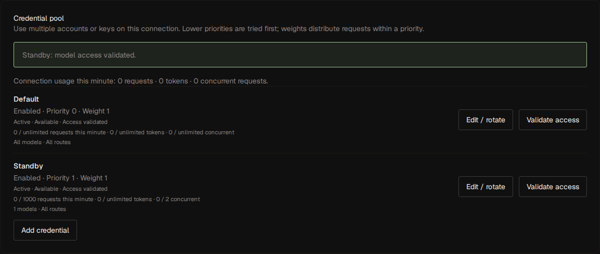

# Provider connections and routing

Published route names form OLP's public model API. A vendor identifies an upstream organization. A provider connection identifies one endpoint, account, region, or deployment and keeps the existing provider ID. Several connections can belong to the same vendor while using different credentials. A connector defines the wire protocol and authentication mechanism used to reach that connection, spanning `openai`, `openai_compatible`, `anthropic`, `gemini`, `azure_openai`, `azure_ai_search`, `vertex_ai`, `bedrock`, `sagemaker`, `watsonx`, and `plugin`.

## Connect and qualify models

1. Choose **Add provider** under Providers and select a vendor. Review the connector, endpoint, authentication, and optional seed model. Vendor identity remains in `configuration.options.vendor_id` when an endpoint is customized.
2. Test the connection, discover models or enter exact upstream identifiers, and select the models to enable. A vendor that publishes no OpenAI-shaped model list, such as Cohere, Voyage, Together, or an account-scoped platform, uses an explicit model for its connection probe.
3. Use **Validate models in bulk**. Keep configured capabilities or choose a generation, embedding, or token-count contract. The console reports failures per model, can stop after the current model, and can retry only failures. Capability probes within a model certification run sequentially, and the server's prober bounds total concurrent outbound probe requests to at most four. The completed-draft probe also checks every enabled model assigned to the default credential, including after rotation.
4. Review the completed draft, test it, and activate. Discovery and model changes remain drafts until activation. Operator model facts are stored separately from discovered identifiers and survive discovery refreshes.
5. In **Compare models and create routes** under Models, select models and review route slugs. An explicitly assigned canonical model identity can group connections automatically. Other models start with distinct connection suffixes, and assigning the same slug explicitly creates multiple targets. Choose the route fidelity for the generated drafts. Strict is preselected, and you should choose transformed when the targets need translation or are Automatic providers (providers without a provider profile). Review the generated drafts before publishing them individually or in bulk.


### Reviewed vendor contracts

`GET /api/v1/provider-vendors` lists the vendor catalog. Each vendor is a reviewed contract in [`internal/domain/vendors`](../../internal/domain/vendors/catalog.go) specifying the operations its documentation lists, the generation dialects it speaks, and the request fields it refuses or spells differently. A vendor is admitted only for the operations its contract lists, so a preset never claims media, moderation, or token counting that its documentation does not describe. Each model and credential still needs certification for the requested operation.

A vendor that documents only Chat Completions is sent Chat Completions, including lossless translation of supported Responses requests, and a profile in another generation dialect is refused for it. Fields a vendor documents as unsupported or ignored are refused before selection rather than silently lost. Cohere's compatibility API, for example, refuses `n`, `dimensions`, and its other documented exceptions. Renamed fields are rewritten automatically. Vendors that document only `max_tokens` receive OpenAI's `max_completion_tokens` under that name, Snowflake Cortex receives the reverse, Mistral receives `seed` as `random_seed`, and Voyage maps `dimensions` to `output_dimension` and float encoding to its native default. A request that sets both names of a renamed field is refused. See the [Voyage contract](https://docs.voyageai.com/reference/embeddings-api) and [Cohere compatibility](https://docs.cohere.com/docs/compatibility-api).

Paid-provider qualification remains an operator activity scoped to the actual account, model, region, and credential.

## Provider lifecycle

An unused draft can be deleted with `DELETE /api/v1/providers/{provider_id}`, using its observed ETag and an idempotency key. Published revisions, route draft references, scoped price history, notification evidence, and retained resource dependencies return `409 provider_in_use`. Deletion cleans the draft's owned sealed material and advances authority. Use disable for published providers to preserve their immutable revisions and accounting history.

A provider is created as a draft with its configuration and a credential unless the authentication mode is `none`, `adc`, `default_chain`, `azure_default`, or a plugin's `grant`, whose credential versions come from [grant enrollment](plugins.md#grant-enrollment). The console wizard runs through five stages.

1. **Probes** the connection (`POST /api/v1/providers/{id}/probe`), listing upstream models or proving a configured deployment or model when that vendor has no model-list API, with bounded time, concurrency, and a 1 MiB response body limit. Probe results store only a status, a timestamp, and a sanitized detail, so upstream bodies never enter persistent diagnostics.
2. **Discovers** models (`POST /api/v1/providers/{id}/discovery`), either from the upstream list or from up to 2,000 declared identifiers. Discovered models start disabled with no capabilities.
3. **Reviews** capabilities (`PATCH /api/v1/providers/{id}/models/{model_id}`), recording *declared* tuples of operation, surface, and mode.
4. **Certifies** each model (`POST /api/v1/providers/{id}/models/{model_id}/certify`), proving each declared operation, surface, and mode tuple sequentially and marking successful tuples as *certified*. An OpenAI-surface generation capability on an Automatic provider proves both Chat and Responses when the vendor speaks both dialects. Review at most 64 tuples per model. Each probe has a 15-second budget, the prober caps concurrent outbound probe requests at four, and the server gives certification an overall deadline of `(len(Vocabulary) + 1) * 15s` (currently 14 minutes 45 seconds for the 58 built-in capability tuples). Only certified tuples of enabled models publish to the runtime and become eligible for routes.
5. **Activates** the draft (`POST /api/v1/providers/{id}/activate`), validating the configuration, requiring current validation for each selectable credential slot and at least one enabled, fully certified model, writing an immutable revision, and publishing a new runtime generation.

Draft edits never change serving traffic. They mark the provider as having a pending activation, and the runtime keeps using the active revision. Changing transport or semantic details (kind, authentication mode, endpoint, cloud addressing, credential headers, parameter defaults, model facts, or vendor) invalidates certification evidence and slot validation, so tuples must be certified again before activation. Re-reviewing capabilities preserves unchanged tuples, removes evidence for deleted tuples, and starts new tuples as declared. Renaming and credential rotation preserve model certification, though rotation still requires fresh slot validation. Revisions can be listed, read, compared, and restored as a new draft. Restoring copies the recorded models and evidence, never a historical credential.

Disabling a provider (`POST /api/v1/providers/{id}/disable`) publishes a generation in which the provider is not selectable. Streams that already started keep the snapshot they were admitted with.

## Private endpoints, headers, defaults, and model facts

OpenAI, OpenAI-compatible, Anthropic, Gemini, Bedrock (including VPC endpoints), SageMaker (including interface VPC endpoints), and watsonx (private regional origins) connectors accept custom endpoints. Azure OpenAI and Azure AI Search always require their explicit resource or search service origin, while Vertex AI uses Google's regional endpoint for the configured project and location.

On `openai`, `openai_compatible`, `anthropic`, and `gemini`, set `auth_mode` to `none` for an explicitly unauthenticated endpoint or to `headers` for encrypted custom authentication. Kinds with a default endpoint (`openai`, `anthropic`, and `gemini`) do not require an explicit endpoint when using `auth_mode: headers`, because normalization supplies their default endpoint when omitted. Kinds without a default endpoint (`openai_compatible`, `azure_openai`, and `azure_ai_search`) always require an explicit endpoint. Private addresses and plain HTTP additionally require the [egress allowlists](../operate/configuration.md#provider-egress-policy). DNS pinning, redirect refusal, and response limits still apply.

For header authentication, list up to 16 header names in `options.credential_headers`, for example `["Authorization", "X-Account-Id"]`. OLP trims whitespace and normalizes header names using `textproto.CanonicalMIMEHeaderKey`, and matches the keys of the write-only JSON `credential` string case-insensitively against the configured names. The JSON object must contain the exact set of configured headers with string values, including the complete `Authorization` value when needed. Reserved transport, framing, and OLP headers cannot be configured. Header values never appear in management reads or error responses.

`options.parameter_defaults` contains provider-wire JSON defaults for Automatic providers. Explicit request values take precedence, including nested generation configuration. Response-format defaults apply only to matching chat, image, or speech endpoints, and an explicit response format replaces the complete format default. Routing, model, messages, input, stream, and other envelope fields cannot be overridden through defaults. Native HTTP connectors support these defaults, whereas Vertex AI and Bedrock retain their native cloud configuration.

`options.models` maps upstream model identifiers to operator model facts.

```json
{
  "models": {
    "account/model": {
      "canonical_model": "organization/model",
      "context_length": 131072,
      "max_output_tokens": 8192,
      "supported_parameters": ["temperature", "max_output_tokens", "tools"],
      "input_modalities": ["text"],
      "output_modalities": ["text"],
      "region": "eu-west",
      "quantization": "bf16",
      "data_collection": false,
      "zero_data_retention": true,
      "source": "Operator-reviewed account agreement",
      "observed_at": "2026-09-09T00:00:00Z"
    }
  }
}
```

Unspecified facts remain unknown. Privacy declarations require a source and an observation time. `deployment` overrides the wire model for native HTTP connectors, and Azure overrides select an exact deployment path. Changing relevant connection options invalidates previous certification evidence. A custom endpoint never inherits official OpenAI media certification merely from its connector selection.

## Credential pools and limits

Manage credential versions under `/api/v1/providers/{id}/credentials` and up to 64 slots (including the required default slot) under `/api/v1/providers/{id}/credential-slots`. Secrets are sealed and write-only, and mutations require observed ETags and idempotency keys. Individual slot ETags allow concurrent edits to sibling slots, while collection edits keep collection fences. Deleting a nondefault draft slot removes pending enrollment without affecting immutable published history.

Slots carry enabled, priority, and weight settings along with optional allowed model, route, and API key restrictions. Empty restriction lists are unrestricted within the connection. Lower priority followed by weighted rendezvous chooses among eligible slots. Every serving slot must validate all allowed enabled certified capabilities sequentially, using the same 15-second per-probe budget and `(len(Vocabulary) + 1) * 15s` operation deadline (currently 14 minutes 45 seconds) as model certification. Validation evidence binds the credential, transport settings, and capabilities, so concurrent changes invalidate it. Disabled slots and slots with no allowed enabled models neither serve traffic nor block activation.

Rotation validates and stages a new credential version while active traffic keeps using the old version until reactivation. Model certification can validate the usable slot it selects, while additional or rotated slots need their own validation proof. Secretless authentication modes still honor default slot restrictions and quotas. Published options, contracts, versions, and attempt price pins remain immutable, while new admissions evaluate current published count quotas.

`options.commitment` declares provisioned capacity as `{"amount": "<decimal>", "period": "hour"|"day"|"month"}`. Priced usage on the connection settles at zero marginal cost and the commitment allocates across each period's list-cost weight, as [Pricing](../operate/pricing.md#commitments) describes.

Connection `options.limits` and per-slot RPM, TPM, and concurrency quotas both apply. Valkey owns UTC minute windows and active leases, and configured quotas fail closed. Logical quota identity survives credential rotation. Dispatched combined token reservations cannot decrease, and settlement releases concurrency leases. `priority_shares` sums to 100 across `critical`, `high`, `normal`, and `low`, paired with a `saturation_percent` from 1 to 100. Below saturation, any priority class can borrow idle capacity. Above saturation, atomic shares preserve headroom across replicas.

```json
{"max_concurrency":40,"priority_shares":{"critical":50,"high":25,"normal":20,"low":5},"saturation_percent":60}
```

Providers with separate input and output quotas accept `input_tokens_per_minute` and `output_tokens_per_minute` on connection `options.limits` and on each slot alongside `tokens_per_minute`. Each configured dimension enforces independently, an unset dimension is unbounded, and a combined-only configuration behaves as before. Before dispatch, one atomic reservation holds the estimated input and a bounded output allowance against the connection and slot counters shared by every replica without changing the request. The output allowance is the reply bound named by the request or provider defaults, or 4,096 tokens when neither sets one, per requested candidate. Subscription code requests and Gemini interaction continuations hold the same allowance. A request exceeding either dimension is refused on that target before dispatch, routing tries the next candidate, and the refusal names the exhausted dimension. When usage is reported, the input and output counters settle to actual usage, with input excluding tokens read from the provider prompt cache so unused output allowance returns within the same minute. Missing or uncertain usage keeps the reservation, settlement applies at most once, and the combined counter still never decreases.

OLP accounting differs from a provider's accounting in ways operators setting split limits should plan for. OLP windows are fixed UTC minutes, whereas providers commonly replenish continuously, so capacity returns at different moments. OLP estimates input with its own tokenizer until upstream usage arrives, and its estimate counts the whole prompt even if a provider excludes prompt-cache reads up front. OLP holds the full output bound until the attempt ends, whereas a provider counts output tokens as they are produced and ignores the bound, so an oversized `max_tokens` holds output capacity in OLP that costs nothing upstream. Keeping `max_tokens` near the expected reply size avoids holding unnecessary capacity. A request whose output bound alone exceeds the output limit never dispatches on that target. During a rolling deploy, split limits enforce fully once every replica runs a build that supports them.

A deployment model served by several same-project connections under one upstream ceiling can join a shared token quota group through connection `options.shared_token_quotas`, for example `[{"model":"gpt-6.2-sol","group":"upstream-a","tokens_per_minute":250000}]`. Connections in the same project naming the same group share one tokens-per-minute counter independent of individual connections and secrets, and every member declares the same ceiling. For ordinary generation, an attempt is admitted only when the group, connection, and slot reservations all succeed, and a partial failure charges none of them. Moving a model between groups changes future reservations only once the publishing release installs. Leases already taken keep settling in their original group exactly once, and the old group retains its accounting while those leases remain active. The credential pool displays each group's live usage beside the connection usage, and a request refused by the group names the shared quota rather than the connection or credential.

Connection and slot day or month supply caps use exact-decimal PostgreSQL facts, Valkey snapshots, and per-attempt holds. Unknown windows skip targets as `connection_budget_unavailable` or `slot_budget_unavailable`, and exhaustion skips them as `connection_budget_exhausted` or `slot_budget_exhausted`. Windows are never zero-initialized, so use [spend budget reconciliation](../operate/operations.md#spend-budget-reconciliation) when bootstrapping or recovering supply caps.

Optional `health_probe.interval_seconds` (60 to 86,400 seconds, for example 300) sends bounded paid synthetic probes once per routed model per fleet interval with a 30-second deadline. Active health probes run only for `generation`, `embeddings`, and `rerank` operations on transformed routes. Strict routes are skipped because probes send the canonical OpenAI payload shape (or a 16-token `/completions` prompt for a native text-completion profile). Probe usage remains accounted to the installation, and failing health ranks targets last rather than eliminating availability. Shared circuit and slot cooldown evidence distinguishes transport and server failures from credential failures. Credential-only half-open outcomes allow sibling slots to probe. Rotation does not reset logical rate cooldowns, though validated credentials may clear them. See [gateway failure rules](../develop/request-path.md#request-path).

Credential revocation is live authority across old releases and pinned resources. Revoking a provider credential takes effect immediately without checking existing `media_jobs`. Durable media jobs remain pinned to their original credential version, and any subsequent background poll, operator refresh, content download, or delete checks live credential eligibility and fails with `media_job_credential_revoked`. Reconciliation workers claim only runnable capacity, revalidate claims immediately before bounded poll or delete calls, and yield silently on lease takeover.



## Scoped routing policies

`GET /api/v1/routing-policies/{scope}/{id}` reports `configured` alongside its policy and observed ETag. Installation policy uses the nil UUID and requires installation settings authority. API-key policies require key authority, and route-draft policies require configuration authority and project access.

`DELETE` removes an explicit override under the same permissions, observed `If-Match`, and `Idempotency-Key` requirements as `PUT`. The next read reports inherited defaults with a fresh ETag, and any observation from before a create-and-delete cycle remains stale. Non-draft removal publishes the runtime change immediately, whereas draft removal takes effect when that draft is activated. Scoped writes return their exact parent ETag transition, replays return the original transition and outcome, and successful removals are audited.

## Routes

Automation can create a published route with `POST /api/v1/routes` and replace its configuration with `PUT /api/v1/routes/{route_id}`. Both validate and publish an immutable revision in one transaction using the same checks as console draft activation. Creation refuses an existing slug, while replacement requires the observed published ETag and retains its slug, project, and routing policy. Each successful write retains a revision source draft and leaves independent console drafts untouched. Failed validation rolls back the draft, revision, and runtime release, and replaying the same `Idempotency-Key` returns the original result. Published route reads return their own ETag, and retirement preserves revision and accounting history.

A slug is 1 to 100 bytes of lowercase ASCII letters, digits, `.`, `_`, and `-`, starting with a letter or digit. Uppercase letters, slashes, and other characters are refused.

Route drafts carry a slug, allowed operations (defaulting to `generation`), an overall deadline, an attempt budget, and 1 to 64 targets with priority, weight, and timeout. Supported route operations include `generation`, `token_count`, `embeddings`, `rerank`, `moderation`, `decision`, `ocr`, `search`, `classification`, `scoring`, `image_generation`, `image_edit`, `image_variation`, `speech`, `transcription`, `translation`, `video_create`, `video_list`, `video_get`, `video_content`, `video_delete`, `batch`, `realtime`, `bedrock_invoke`, `passthrough`, and the retained resource operations `fine_tuning`, `vector_store`, `retrieval`, `conversation`, `container`, `eval`, `skill`, `context_cache`, and `agent_resource`. See the [compatibility matrix](compatibility.md) for operation contracts.

The overall deadline is 1 to 3,600,000 milliseconds, and target timeouts cannot exceed it. The attempt budget is 1 to 32,767 and counts credential attempts, so it can exceed the target count. Every target must reference a published model with certified support for each allowed operation, and validation and activation reject unknown, inactive, unpublished, or uncertified targets. Drafts are versioned with ETags, so stale edits return `412` and the console offers a reload.

Activating a draft writes an immutable route revision, makes it the latest revision of the route named by the slug, and publishes a runtime generation. Revisions can be compared and restored as new drafts. The simulation endpoints (`POST /api/v1/route-drafts/{id}/simulate` and `POST /api/v1/routing/simulate`) explain the deterministic attempt order for a given seed or key without contacting any provider.

A route revision may also declare fallbacks, selectors, a retry policy, session affinity, and a spend cap, and its targets may carry `tags` and a `shadow` sample rate. Draft endpoints, revision endpoints, revision diffs, restore, and [configuration promotion](../operate/configuration.md#configuration-promotion-artifacts) all carry these fields.

```json
{
  "slug": "assistant",
  "targets": [
    {"provider_model_id": "<small-model-id>", "tags": ["small"]},
    {"provider_model_id": "<large-model-id>", "tags": ["large"]},
    {"provider_model_id": "<shadow-model-id>", "shadow": {"sample_rate": 0.05}}
  ],
  "fallbacks": [
    {"route": "assistant-long-context", "on": ["context_window"]},
    {"route": "assistant-backup", "on": ["exhausted", "content_filter"]}
  ],
  "selectors": [
    {"id": "short", "when": {"max_input_tokens": 2000, "tools": false}, "tags": ["small"]},
    {"id": "reasoning", "when": {"reasoning_effort": ["high"]}, "route": "assistant-reasoning"}
  ],
  "retry": {"upstream_server": {"max_retries": 2, "base_backoff_ms": 200, "max_backoff_ms": 2000, "respect_retry_after": true}},
  "affinity": {"source": "cache_key"},
  "budget": {"daily_cost_limit": "250"}
}
```

### Fallbacks

`fallbacks` lists up to four other routes in order, each paired with the conditions that trigger it.

| Condition | When the fallback runs |
| --- | --- |
| `exhausted` | Every attempt ended without success on a retryable failure class |
| `context_window` | An attempt failed with a context-window refusal, or planning found no target whose context window holds the request |
| `content_filter` | An attempt ended on an upstream content-filter refusal |
| `rate_limit` | An attempt ended on an upstream rate limit or a local quota |
| `budget` | An attempt ended on a supply-side spend cap during planning or before dispatch |

A content-filter refusal is a typed upstream error, such as `content_filter` or `content_policy_violation`. It is terminal within the route, never counts against provider health, and reaches the caller as HTTP `400` with code `content_filter` unless a fallback serves the request.

A fallback route runs with its own targets, policy, and fidelity, while the caller still sees the route it named in the response's `model`. The API key must be allowed to use the fallback route, or planning records `fallback_route_forbidden` and moves to the next fallback. A route that is no longer active is skipped as `fallback_route_unavailable`, and a route the request already visited is skipped as `fallback_route_repeated`. The named route's overall deadline and attempt budget bound the whole request, fallbacks included, and every attempt records the route leg it ran on. A request never falls back once a stream has committed, after an ambiguous resource creation, or when it is bound to its route by a pinned resource, a continuation, or provider state.

Publication refuses any route graph, counting both fallbacks and selector delegation, that has a cycle (`route_graph_cycle`), crosses a project boundary (`route_graph_project_mismatch`), exceeds three routes in depth (`route_graph_too_deep`), or allows a strict route to serve through a transformed route (`route_graph_fidelity_mismatch`). Validation and activation also refuse any reference to a route that is not active (`route_reference_unknown`).

### Request selectors

`selectors` defines up to 16 rules, with at most eight tags per selector or target, evaluated in order so the first matching predicate wins. Its action either narrows the route to targets carrying any of its `tags`, or delegates the request to another `route` the key may use. Plan decisions record the winning selector, and excluded targets carry the reason `selector_excluded`. A predicate is the conjunction of all fields it declares, evaluated over features the gateway computes during admission.

| Predicate | Matches |
| --- | --- |
| `operations` | The planned operation |
| `min_input_tokens`, `max_input_tokens` | The estimated input tokens |
| `min_output_tokens`, `max_output_tokens` | The requested output tokens |
| `streaming`, `tools`, `structured_output` | A streaming request, a request that offers tools, or a request asking for a JSON schema or object |
| `modalities` | Any of `text`, `image`, `audio`, `video`, and `file` among the input parts |
| `reasoning_effort` | The request's reasoning effort, such as `high` |
| `classifier` | The label returned by another OLP route |
| `plugin` | The verdict of an approved confined plugin |

Attribution labels never take part in selector predicates, keeping attribution free of routing effect.

A `classifier` predicate, such as `{"route": "triage", "labels": ["complex"], "min_score": 0.7, "timeout_ms": 500}`, sends the text of the request's last user turn, up to 32 KiB, to another OLP route. A route serving `classification`, such as a TEI classifier, answers with its top label and score, whereas a generation route answers with its reply text as the label. The classifier call is an accounted request of the caller's key with origin `classifier` and the caller's request as its parent, bounded by its own deadline. A classifier that fails, times out, or is forbidden to the key falls through to the next selector, recorded as `classifier_failed` or `classifier_forbidden`.

Classifier timeouts cannot exceed 30 seconds, and each classifier route is evaluated at most once per request.

A `plugin` predicate names a confined plugin by its digest (`{"digest": "<sha-256>"}`) and asks it to judge the same admission features through the `route_predicate` method ([route predicates](../develop/plugin-authoring.md#route-predicates)). The plugin must be approved when the route is validated (otherwise validation fails with `route_plugin_unavailable`), and a plugin call that fails or exceeds 250 milliseconds falls through as `plugin_failed`. A plugin predicate can only narrow the candidate set.

`GET /api/v1/usage/selector-savings` compares each selector's attempts with what their own usage would have cost on the most expensive eligible target the selector avoided, priced when each attempt was accounted. Attempts missing either price are counted without comparison so the report never invents usage.

### Retry policy

`retry` declares, per retryable failure class (`connect`, `timeout`, `rate_limit`, and `upstream_server`), how many times an attempt repeats on the same slot before the route fails over. It accepts `max_retries` up to 10, `base_backoff_ms` and `max_backoff_ms` up to 60 seconds with full jitter, and `respect_retry_after` to honor an upstream `Retry-After` header. Retries consume the attempt budget and overall deadline, are recorded as attempts with their retry number, never apply after stream commitment or to an ambiguous creation, and stop once the provider's circuit opens. The slot cools down only after its retries are exhausted.

### Session affinity

`affinity` keeps requests from one session on the same target and slot while it stays eligible, raising provider prompt-cache hit rates without gateway session state. The session key comes either from an attribution label (`{"source": "label", "label": "session"}`) or from the dialect's own cache key (`{"source": "cache_key"}`, which reads OpenAI's `prompt_cache_key`). OLP hashes that session key into the rendezvous seed in place of the API key's identity, while requests without one keep the API key's seed.

### Shadow targets

A target declared with `{"shadow": {"sample_rate": 0.05}}` never serves callers. It is planned with the request under every hard constraint that applies to the request, including region, data collection, and zero data retention. A sample of eligible requests, chosen deterministically from the request's identifier, is mirrored to the shadow target after the caller's response completes. Shadow attempts run in their own admission pool (`OLP_HTTP_MAX_IN_FLIGHT_SHADOW_REQUESTS`) under the route's deadline and drop rather than queue when that pool is full, so they never alter caller responses. Only stateless generation, embeddings, and rerank requests are mirrored, never requests with provider state, continuations, pinned resources, files, batches, realtime sessions, or media. Shadow requests record origin `shadow` with the caller's request as their parent and are accounted to the route rather than the caller's key, budget group, or end-user budgets, while aggregate installation and project caps still apply. `GET /api/v1/usage/shadow-experiments` compares each shadow target with the primary path of mirrored requests by status, latency, time to first byte, token usage, and cost using metadata only. Every route requires at least one serving target.

### Route spend caps

`budget` declares a route's own `daily_cost_limit` and `monthly_cost_limit`, shared across all of its targets. An exhausted cap removes the entire route from selection with the reason `route_budget_exhausted` and can start a `budget` fallback. An attempt refused by any supply cap at dispatch returns `503 supply_budget_exhausted` when no fallback serves the request.

### Route templates

A route template turns certified models into ordinary routes. It names a provider selector (`vendor:<id>` or `provider:<uuid>`), a case-insensitive model filter where `*` matches any run of characters and `?` matches one character, a slug pattern built from `{model}` (the model's canonical identity) and optionally `{vendor}`, an overall deadline, an attempt budget, a fidelity, a routing policy, and whether to publish automatically.

```json
{"name": "claude", "provider_selector": "vendor:anthropic", "model_filter": "claude-*", "slug_pattern": "{vendor}-{model}", "overall_timeout_ms": 120000, "max_attempts": 2, "auto_publish": true}
```

Manage templates under `/api/v1/route-templates`. When a provider activation certifies a matching model, the template creates a route draft, or a published revision when `auto_publish` is set, within the activation's transaction. `POST /api/v1/route-templates/{template_id}/apply` places every matching model immediately. A second connection serving the same identity joins the same generated route as another target. A template places each model once, records why any model was skipped (`slug_taken`, `operations_not_certified`, `targets_full`, or an activation refusal), and never creates a route for an uncertified model, so nothing reaches callers without certification. Every generated route is an ordinary route with its own revisions, simulation, and access control.

### Route fidelity

`fidelity` is `{"mode":"strict"}` or `{"mode":"transformed"}`. When omitted, null, or empty, fidelity defaults to `strict` and is never inherited, while revisions and exports record the explicit mode. Invalid values return HTTP 422. Every strict target compiles its native operation contract, so Automatic providers, non-strict profiles, cross-surface translation, or redaction refuse with `target_capability` or a policy conflict. Header and authentication-only plugin adaptations may serve strict routes, whereas plugins that envelope or rewrite bodies, force upstream streaming, or carry traffic require transformed routes.

Use transformed routes for cross-surface translation, redaction, Automatic providers, the console playground, and Bedrock InvokeModel normalization. Provider-owned state on transformed routes retains metadata mappings only. New revisions can change fidelity without renaming slugs, and restoring a revision restores its original mode.

Retained resources obey their creation fidelity. Strict resources cannot be read, recovered, or used to start work through transformed ingress (returning HTTP 409). Transformed resources may still be read through strict ingress, though they cannot start new work there. Lists return owned stored metadata without polling incompatible resources, and owners can still delete or cancel resources after a fidelity switch. See [compatibility](compatibility.md) for operation contracts.

## Policies and caller preferences

Policies live at installation, route revision, and gateway-key scopes. Edit them through **Settings**, the route draft editor, the API-key editor, or `GET` and `PUT` on `/api/v1/routing-policies/{scope}/{id}`. Scopes are `installation`, `route-draft`, and `api-key`, with the nil UUID as the installation ID. Installation and key changes publish immediately, whereas route policy changes are staged and published with the route. Policy writes require the matching management permission and current ETag.

Hard constraints intersect across all scopes and the request. They include `only`, `ignore`, `regions`, `quantizations`, `deny_data_collection`, `require_zero_data_retention`, `require_parameters`, `max_price`, and `max_cost`. Selectors take the form `vendor:<catalog-id>` or `provider:<connection-uuid>`. Unknown facts cannot satisfy a required constraint. Constraints placed inside policy defaults also narrow eligibility without granting additional access.

`max_cost` is an exact-decimal ceiling on a request's worst-case attempt cost, matching the bound the gateway would reserve from the highest input-side rate for the estimate, the declared or default reply allowance, the per-request fee, the window multiplier, and the attempt's pinned discount. Every scope that sets `max_cost` narrows it, so the effective ceiling is the smallest value. A candidate whose worst case exceeds the ceiling, or cannot be bounded at all, becomes ineligible with the `cost_limit_exceeded` reason, whereas a committed provider bounds at zero and always passes. When no non-shadow target remains eligible for that reason, the request fails with HTTP `400` and code `cost_limit_exceeded` before dispatch without triggering fallback, while fallback legs that do run enforce the same ceiling.

Ordering and strategy preferences use request, key, route, and installation precedence in that order. A policy can restrict `allowed_strategies`. `order` takes precedence over the strategy inside an operator priority tier. With `allow_fallbacks: false`, an explicit `order` restricts attempts to that list, and without an order only the first eligible attempt is selected. Requests cannot add published targets, raise deadlines or attempt limits, or broaden policy constraints.

All native inference surfaces accept one optional `X-OLP-Routing` header.

```http
X-OLP-Routing: {"only":["vendor:deepseek"],"strategy":"price","max_price":{"input_per_million":"0.50","output_per_million":"2.00"},"max_cost":"0.25"}
```

The header also selects the request's admission `priority`, such as `{"priority":"high"}`, up to the ceiling its key's policy permits. Any higher priority value is refused with `priority_increase_forbidden`. Priority governs admission and capacity shares rather than target selection and is not a routing-policy control.

Malformed JSON, unknown controls, and invalid selectors are rejected before dispatch. The header is never forwarded upstream, and standard header-size limits apply. Strict parameter filtering additionally requires affirmative model support for supplied canonical parameters and semantic extensions. Semantic loss checks always apply even when strict parameter filtering is off. Media controls include `n`, `size`, `mask`, `voice`, `response_format`, `language`, `prompt`, and `input_reference`, excluding internal cleanup markers.

| Strategy | Ordering within a priority and preferred-order tier |
| --- | --- |
| `weighted` | Deterministic weighted rendezvous, which is the default |
| `price` | Exact decimal rates, comparing input plus output per million for generation, input for embeddings, and unit rate for other units |
| `latency` | Median time to first meaningful output for streams and total attempt latency for unary operations |
| `throughput` | Median generated output tokens per second after first meaningful output, excluding reasoning tokens |
| `capacity` | Remaining headroom of each credential slot, calculated as the smallest remaining request, token, and concurrency fraction across its connection and slot in one pipelined Valkey round trip, with unquoted slots ranked after slots with known headroom |
| `bounded_cost` | Exact-decimal upper cost estimate of this request on each target for generation only, leaving targets without a bound in weighted order after the ranked ones |

`bounded_cost` prices the actual request instead of comparing rate sums, so a long prompt with a short reply can prefer a target that `price` would not. It applies only to generation and only inside the tier that health, priority, locality, and preferred order already establish, after every eligibility check including `max_cost`. Each candidate's upper estimate is the worst case the gateway would reserve with the attempt's pinned discount, with committed providers bounded at zero and missing bounds never treated as zero. When at least two candidates in a tier have a bound, they rank by that bound, ties fall back to weighted order, and candidates without one follow in weighted order with `bounded_cost_fallback_reason` set to `cost_bound_unknown`. When fewer than two have a bound, the whole tier keeps weighted order and each candidate reports `insufficient_cost_bounds`. A route with `caller_cost_exempt` bounds no attempt's cost and always keeps weighted order with `insufficient_cost_bounds`, though route explain still shows each target's estimated cost for information. Non-generation requests keep weighted order and report `operation_not_generation`. Fallback never restores a target that eligibility already excluded.

Prices resolve connection scope before vendor scope before connector-kind scope, then select the latest effective revision. Future rates become eligible at their effective time. Missing required price components fail a price ceiling, and unknown prices rank after known prices. Routing and accounting preserve the selected revision, including an explicit unpriced decision.

Performance aggregates use five minutes of persisted successful attempts, partitioned by connection, model, operation, and mode. At least 20 samples are required. Snapshots refresh every 10 seconds and expire after 60 seconds. Unknown measurements rank after known measurements and use weighted order when all are unknown. `preferred_max_latency_ms` and `preferred_min_throughput` favor matching observations as preferences rather than response guarantees.

Targets marked unhealthy by a shared circuit or an active health probe move to the end of the attempt order rather than disappearing, so a fleet-wide false positive degrades latency rather than availability.

Eligibility filtering precedes ordering and `max_attempts`. Each actual credential attempt consumes the route's attempt budget, which can exceed the target count. Fallback never restarts a committed stream, an ambiguously created media job, or a request carried by an unconfined plugin whose outcome is unknown (see [carrying traffic](plugins.md#carrying-traffic)).

## Explain and observe


`POST /api/v1/routing/simulate`, draft preview, and playground preview share the execution planner. Supply operation, surface, mode, and preferences along with an optional key, seed, and native request. Results include exclusions, attempt order, credential slots, prices, measurement freshness, and target-prepared input tokens, provenance, and model family. A generation preview shows the model's context limit, estimated input, any per-completion output reservation used for the window check, and remaining headroom. The input breakdown adds up to the estimate and separates instructions, conversation, tool schemas, tool calls and results, media, and unclassified input such as message framing. When no output bound applies, headroom is calculated after input alone. An unknown model limit or unmeasured provider-held context leaves headroom unknown. These values are planning estimates rather than billed usage, and preview neither sends inference nor stores request content.

Simulations also report each target's `estimated_cost`. Its `minimum` prices the input estimate at the cheapest input-side rate in the selected tier plus any per-request fee, while its `maximum` is the worst case the gateway would reserve. For generation, the estimate also names `priced_input_tokens`, `reserved_output_tokens`, and `currency`. Each decision separately reports the effective `max_cost` ceiling that admitted or excluded it, or `null` when no scope set one, keeping the descriptive estimate distinct from the admission rule. Server-side tool fees and batch multipliers are not bounded. The pair is `null` when the target's price cannot bound the request or when no token demand is known. An explicit estimated count applies to all targets without provenance. Admission additionally reserves reply bounds and larger source-prepared bounds, so simulation is not a dispatch guarantee. Decisions have no bounded maximum, so a target whose key, route, provider, or eligible slot caps require a bounded cost is marked incompatible with `unbounded_work_budget` (see [Decisions](compatibility.md#legacy-text-completions-and-decisions)). When a key is supplied, simulated attribution labels resolve through key and project policies, labels the key cannot set are rejected, and attribution-scoped budgets apply.

Structured JSON parsing through OIF defaults to `MaxNodes` of 65,536 JSON values, and guardrails content inspection enforces `MaxContentBytes` of 8 MiB per evaluation. Requests or outputs that exceed those bounds are rejected before dispatch or delivery rather than bypassing inspection.

Explain traces selectors (accepting optional `classifier_labels` substitutes), delegation and fallback planned, standby, and skipped legs, session affinity, capacity headroom, shadow targets, and unhealthy targets. Selectors never read attribution labels, while configured session affinity may. Live capacity and authority can still change between preview and serving.

### Check a draft against saved fixtures

Open a saved route draft and choose **Check saved request fixtures**. Select a local JSON file, then choose **Compare fixtures**. The check needs an active published revision for the same slug and project and always compares against the currently active revision, even if the draft started from an older one.

Keep the file local and use only invented requests, names, and classifier labels. Never copy production prompts, credentials, real identifiers, or personal data into it. OLP accepts up to 16 uniquely named fixtures in a 256 KiB JSON file. The file is sent only to the management API and is not stored, and the check does not run inference, tools, classifier routes, or selector plugins.

```json
{
  "synthetic": true,
  "fixtures": [
    {
      "name": "Structured output",
      "operation": "generation",
      "surface": "openai",
      "mode": "unary",
      "seed": "regression-suite",
      "expect_eligible": true,
      "request": {
        "model": "replace-with-your-route-slug",
        "messages": [{"role": "user", "content": "Return a JSON object naming a green square."}],
        "response_format": {"type": "json_object"},
        "max_completion_tokens": 128
      }
    }
  ]
}
```

Each fixture pair runs against one configuration snapshot with the same request, seed, observed routing inputs, and planner time. The report highlights changes in eligibility, the first planned attempt, selector outcomes that affected the request or could not be evaluated, and exclusion reasons. Target details include context window estimates where available. Optionally set `dialect` and supply `classifier_labels` keyed by selector ID. When a needed classifier verdict is absent, the trace reports `classifier_not_simulated` and skips that selector. When the project requires attribution labels without defaults, supply synthetic values in each fixture's `attribution` map.

This is a point-in-time planning check. Pricing, performance, and credential eligibility can change between runs. Live capacity, spend, and circuit state are excluded, so a configured spend cap without a reading stays unknown and can exclude a target. Checks have no caller API key and cannot verify key-specific policies or gateway tool execution.

For CI, use a management token with read scope and access to the draft's project. An HTTP 200 response means the comparison ran, and its `passed` field is `false` if any `expect_eligible` assertion failed on the draft. Set `true` to require a serving attempt, `false` to require no attempt, or omit the field to report changes only. The response includes the baseline revision, draft ETag, planning time, and per-fixture results with no request bodies.

```sh
olp api check_route_draft_fixtures DRAFT_ID --body-file fixtures.json --output fixture-report.json &&
  jq -e '.passed' fixture-report.json
```

Request history records immutable connection, slot, credential version, revision, policy, and price references along with retry, fallback, leg, selector, cap, origin, parent, and meaningful output timing metadata. It never stores prompts, outputs, secret headers, or raw controls.
